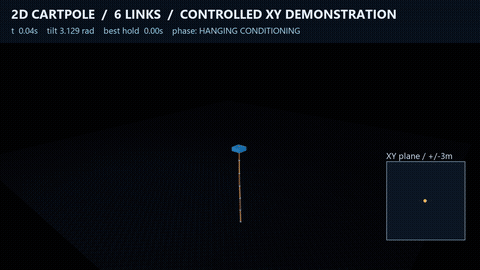

# Spatial freedom audit and controlled XY demonstration

The simulator is genuinely spatial. The higher-count nominal swing references
are often planar because they inherit planar motion proposals. These are
different claims: unrestricted dynamics do not force a controller to choose a
changing-direction trajectory.

The compiled 1-, 3-, and 7-link models have two independent cart slides, three
rotational DOFs per ball joint, no equality constraints, no joint limits and
no joint actuators. The seven-link model has 23 velocity DOFs: two cart and
21 rotational. Every joint responds to both transverse rotations; passive
axial spin also evolves.

Matched X/Y force probes agree under a 90-degree rotation within 2.56e-15.
An independent persistent MuJoCo rollout, which does not use the environment's
state-reset/query helpers, matches the recorded environment states exactly.
Changing-direction XY force probes produce genuinely rank-two cart paths and
nonplanar rod directions. See [native audit results](physics_audit/summary.json)
and [equal-scale XY plots](physics_audit/xy_motion_audit.png).

The recorded four-, five-, and six-link nominal references are essentially
planar. Their qualification runs do use Y feedback: the six-link cohort reaches
0.099m in Y and applies up to 4.98N in Y. Two links already uses substantial
nominal two-axis motion. The higher-count videos should be described as planar
reference swings stabilized in unrestricted spatial dynamics, rather than as
deliberately nonplanar swing maneuvers.

## Controlled six-link XY demonstration

The [full 30-second video](controlled_xy_orbit.mp4) uses the qualified six-link
controller through capture, then commands an XY loop beginning at **18 seconds**.
All six rods continue to target upright. Only the two legal cart forces act;
the physical model, force cap, boundaries and episode duration are unchanged.

Nominal plus three noisy development starts pass complete 30-second episodes,
exact native replay and 14.06 seconds of continuous upright hold. During the
loop, the cart spans approximately **1.116m in X and 0.912m in Y**; its minor/major
path ratio is 0.778. Every world rod tilt remains below **0.02337rad** during
that phase. This demonstrates controlled two-axis motion; it is a separate
four-episode audit task, not a new link-count qualification.



## Reproduction

From this audit directory in the repository, use Python 3.11 and the locked
dependencies. The bundled `src` tree is the audit runtime; the exact original
audit and demonstration snapshots are retained in their result directories.

```powershell
py -3.11 -m venv .venv
.\.venv\Scripts\python.exe -m pip install -r requirements-lock.txt
.\.venv\Scripts\python.exe -m pip install -e .
.\.venv\Scripts\python.exe -m pytest -q
.\.venv\Scripts\python.exe scripts/audit_spatial.py --evidence-root ../../evidence --additional-evidence-root evidence --out output/recheck_physics
.\.venv\Scripts\python.exe scripts/nonplanar_demo.py --route controlled_demo/input_route.npz --out output/recheck_orbit
```

The original physics audit used 4420 native physics steps. The full suite has
44 passing tests, including multi-axis persistent native replay, X/Y force
symmetry and each joint's transverse freedom and spin. The original accepted
six-link release and its files remain unchanged.

Seven's first candidate failed qualification at **31/32**, including a Y-boundary
exit. Its full failed cohort is preserved in this audit bundle. At that audit
checkpoint, the highest qualified count was six. This audit does not qualify
seven; later repaired controllers and their count-specific releases are separate.
