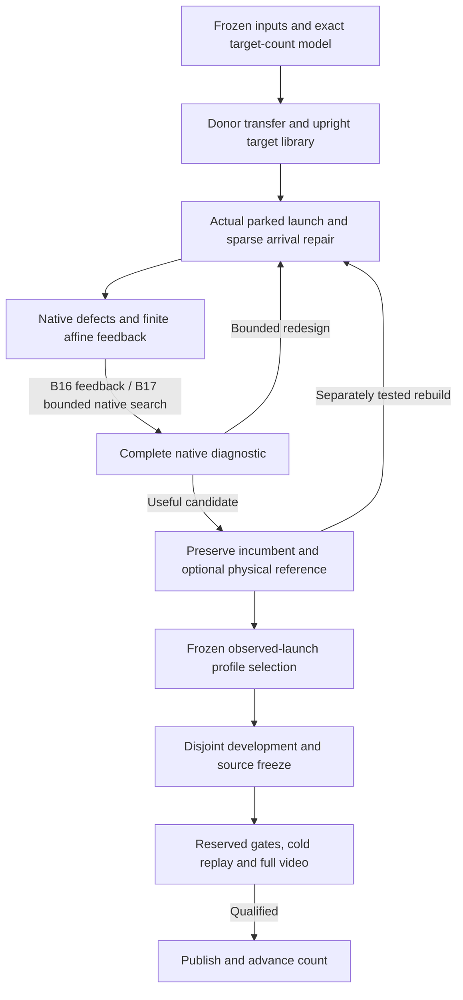

# Corben–Marc Hybrid: Pushing the 1D Cart-Pole Frontier

**Technical proposal for Corben and Marc to review · October 16, 2026 · Revision 3**

**Scope:** the canonical one-dimensional rail cart with a passive planar hinge chain.
The independent 2D cart / spatial ball-joint project is outside this document.

**Status:** proposed architecture. Source inspection, hash checks, saved-tape scoring,
and an algebraic feedback comparison are complete. No new hybrid native episode,
hybrid qualification, or independent native reproduction has been demonstrated by
this review. Marc's published seventeen-link result is the strongest external
baseline considered here. Its source archive has now passed the byte-inventory
checks in Section 2.5; native reproduction remains a separate task.

Marc's synthesis export is pinned to
[3aa4beaf1f2ff84eabfd91b3172831e5f7990068][M0].
The newly published seventeen controller is separately pinned to
[45326b078c54fff1265f5dfa4d48408a74ca4a6c][N0].
Corben's local research includes unreleased work beyond the published fourteen-link
source. Implementations were snapshotted for the [source review][A3]. Private
observations are identified in the source register and summarized here; the
proposal does not assume Marc can open Corben's private filesystem.

**The proposal in one paragraph.** Keep Marc's demonstrated moving-target bridge,
full affine value and bounded native action search as the execution backbone.
Use Corben's count-transfer, sparse constrained repair and native-agreement tools
to make the next target reachable with better measured margins. Refine the bridge,
entry phase and short tail together under a small fixed budget. Admit each candidate
using the exact complete native policy, including its action search, and preserve
the best actual controller throughout. Establish the method at known counts,
then test eighteen and above without treating failed finite search as a limit.

**What would be most useful from Marc's review:** whether the constructions are
represented accurately; which entry/target refinements look most plausible given
his failed attempts; and what would make independent seventeen-link synthesis
reproducible. Focused questions are in Section 22.4. For a first pass, Sections 1,
4, 10.6, 13.5, 19 and 22 contain the central decisions; the other sections supply
the technical contracts and evidence.

## Contents

1. [Recommendation and intended outcome](#1-recommendation-and-intended-outcome)
2. [Evidence, lineage, and current boundaries](#2-evidence-lineage-and-current-boundaries)
3. [The benchmark that stays fixed](#3-the-benchmark-that-stays-fixed)
4. [What each approach contributes](#4-what-each-approach-contributes)
5. [Overall architecture](#5-overall-architecture)
6. [The task objective and timing](#6-the-task-objective-and-timing)
7. [Target-count mechanics and transfer](#7-target-count-mechanics-and-transfer)
8. [Parking and launch preparation](#8-parking-and-launch-preparation)
9. [A library of upright continuations](#9-a-library-of-upright-continuations)
10. [Repairing the arrival bridge](#10-repairing-the-arrival-bridge)
11. [Finite affine feedback and the design horizon](#11-finite-affine-feedback-and-the-design-horizon)
12. [Physical references and feedback-aware refinement](#12-physical-references-and-feedback-aware-refinement)
13. [Quantization, numerical precision, and sensitivity](#13-quantization-numerical-precision-and-sensitivity)
14. [Native selection and bounded action correction](#14-native-selection-and-bounded-action-correction)
15. [Robustness and qualification](#15-robustness-and-qualification)
16. [Experiments that identify the useful ingredients](#16-experiments-that-identify-the-useful-ingredients)
17. [Compute, memory, and stopping budgets](#17-compute-memory-and-stopping-budgets)
18. [Implementation contracts and work packages](#18-implementation-contracts-and-work-packages)
19. [Failure diagnosis and recovery](#19-failure-diagnosis-and-recovery)
20. [The role of learning](#20-the-role-of-learning)
21. [How to investigate the actual threshold](#21-how-to-investigate-the-actual-threshold)
22. [Count progression, publication, and immediate next work](#22-count-progression-publication-and-immediate-next-work)
23. [Sources and retained evidence](#23-sources-and-retained-evidence)

## 1. Recommendation and intended outcome

Build a reusable procedure that discovers a complete, reachable, controllable
continuation from a hanging start to the end of the episode.

The recommended first implementation combines:

- **Corben's route discovery and material-coordinate transfer** for supplying
  physically meaningful starting proposals at the next count.
- **Marc's early bridge into a moving upright reference** as the initial successful
  architecture to reconstruct, including the new seventeen-link 6.25 Hz example.
- **Affine square-root finite-horizon feedback**, including native transition
  defects, affine offsets, exact controller arithmetic, and explicit horizon provenance.
- **Corben's native-agreement constrained repair and physical-reference tools**,
  introduced through matched comparisons against Marc's working IPOPT construction.
- **Bounded native action improvement using the complete affine value**, with
  seventeen's cap of sixteen distinct delivered candidates per active command.
- **Complete native continuation admission from the observed launch state**,
  running the same action search as execution and retaining its computation.
- **The existing complete physical qualification gates**, unchanged.

The central design choice is to optimize arrival into a continuation we can
actually execute. Stationary upright balance remains one target candidate.
Small moving upright trajectories add other destinations that satisfy the same
world-angle criterion.

A moving reference is allowed to have nonzero link rates and nonzero bounded
force while remaining upright. Requiring every successful arrival to have zero
state and an indefinitely stabilizing stationary controller imposes an additional
condition beyond the finite benchmark. The new target library should expose that
choice explicitly.

Use frozen fifteen/sixteen/seventeen payloads as early reproduction baselines.
Qualification of the combined method proceeds through fifteen, sixteen and then
seventeen, with independent synthesis distinguished from payload execution.
Seventeen is an external demonstrated reference point. Eighteen through twenty are the
next proposed frontier campaign; twenty is a milestone, not a presumed upper limit.
Neither Marc's release nor this design promotes our own accepted frontier beyond
fourteen. Further counts require the same count-by-count evidence.

The architecture's advantage is a hypothesis. It must beat fixed baselines on
complete native episodes, reliability, useful margins, or total computation.

## 2. Evidence, lineage, and current boundaries

### 2.1 Use four evidence labels

| Label | Meaning | Permitted conclusion |
|---|---|---|
| Demonstrated release | A particular frozen controller passed its documented gates | That controller passed those finite conditions |
| Retained component or diagnostic | A local orbit, reference, model, exact start, or limited perturbation study | The measured component property |
| Interpretation | A proposed explanation consistent with observations | A reason to select a discriminating experiment |
| Proposal | An unexecuted integration or experiment | A concrete next test |

A passed cohort is not a proof of arbitrary disturbance rejection. An orbit is
not a hanging-start controller. A successful saved controller is not independent
automatic re-synthesis. A failed finite search is not an impossibility result.

### 2.2 The actual donor relationships

Corben's highest accepted published 1D count is fourteen. Its release includes
reserved noisy 20/20, disjoint noisy 100/100, exact 20/20 and one held-out video,
all completing thirty seconds and holding upright for 8.16 seconds. The public
fifteen result remains a nominal three-second partial hold followed by failure.
The local Windows investigations have their own outcomes; do not relabel the
archived Mac partial result as a Windows reproduction. [C1] [C7]

Marc's fifteen construction starts from Corben's partial-fifteen actual tape.
Its repaired planning reference was followed by a successful native value-control
episode. A 700-command physical prefix of that episode became the selected
reference. Marc's sixteen construction starts from Corben's fourteen controller
and material-coordinate lift. Its successful destination was a separately
constructed moving orbit. [M2]

This is already an exchange of useful ideas and artifacts. The next hybrid
should make the construction reusable and its improvements measurable.

### 2.3 What the new export makes inspectable

The export supplies original source, numeric checkpoints, original-versus-portable
metadata identities, public reconstruction adapters, and retained validation.
The earlier review's statement that sixteen's synthesis source was unavailable
is superseded by this separately pinned review.

The review independently checked the 91 entries in the original manifest and
153 entries in the export manifest; these are overlapping manifest counts.
It verified fifteen's physical-reference prefix and sixteen's released prefix,
and rescored nine saved tapes. These checks added zero native transitions. [A1]

### 2.4 Results that affect the design

| Observation | Design implication |
|---|---|
| Fifteen's first successful actual tape holds for 24.18 seconds | Native correction can generate a better physical reference |
| Sixteen's first nominal pass uses early-bend finite affine feedback without the later selector | Route/feedback construction and robustness selection are separate interventions |
| The selected sixteen reference retains a native gap near 3.06e-6 | Reference feasibility and closed-loop task success need separate fields |
| The released sixteen is a 650-entry prefix of a 700-step design | Feedback design horizon must be preserved |
| Small local orbit perturbation tests are fragile | Orbit closure and gain norms cannot define a generic capture basin |
| Locally reconstructed QR coefficients are close but not byte-identical | Frozen execution and local regeneration need separate baselines |

The [review audit][A1] records the array comparisons. The [author's validation
record][M10] distinguishes regenerated stages, new diagnostics and retained gaps.
The exact first fifteen online action-selection history is not fully recovered
by the later successful rerun: the first differing command is 489. Its exact
historical physical-reference checkpoint remains available.

### 2.5 The new seventeen publication changes the baseline

The new arena commit reports exact calibration, development 20/20 and 100/100,
and reserved 141/141; its reported minimum hold across 262 actual recordings is
7.36 seconds. Native replay coverage is calibration plus the 141 reserved
episodes, **142 episodes total**; development tapes were rescored. These are
author-attested results, not an independent native reproduction here. [N1]

| Element | Published seventeen configuration | Consequence for the hybrid |
|---|---|---|
| State | Native q18/v18, 36 binary64 coordinates | Build at the target count; no latent state needed |
| Destination | 6.25 Hz orbit; nominal amplitude parameter 0.14 | Preserve this seed alongside sixteen's 5 Hz seed |
| Entry | Blend begins at route tick 150; bridge ends at 450 | Early preparation remains part of construction |
| Clocks | 850 parking, 650 execution, full 700 value design | Preserve the unexecuted design guard and complete value arrays |
| Defect | Metadata reports original native reference gap about 3.1082e-7 | Keep approximate-reference and actual-replay status separate |
| Action search | Starts at route tick 0; R=1000; at most 16 distinct F32 candidates | Search is a primary baseline, not merely a late rescue |
| Outer admission | One zero-offset complete 650-command forecast | Multiple offset profiles are not required by this release |
| Value | Roots and affine residuals at all 701 design states | Gains alone cannot reproduce the search |
| Learning | None adopted | Keep the failed learning probe separate |

The amplitude parameter is not a measurement that every link reaches exactly
0.14 rad, nor permission to relax the strict 0.15-rad gate. Sixteen's tighter
orbit-screen bounds must not silently reject this different construction.
Metadata and stored arrays are exposed; the complete 17 route/orbit optimization
worker and every earlier failed candidate are not established by this public
inventory. [N2] [N3] [N4]

The preceding review checked **51 available Git-checkout files** listed by the
candidate manifest, inspected its 18-field payload and literal 650/700 prefixes,
and rescored one retained prequalification exact diagnostic: 1,500 commands,
368 upright post-states / 7.36 seconds, maximum cart magnitude about 1.94031948 m.
This is saved-array verification, with zero native integration. It is not a
rescore or replay of the 262-episode release. [A5]

**Packaging status, rechecked for this revision:** the public source archive is
now available. Its SHA256 matches the registry and release-asset digest:

    6341bcbbfdc2c76837f3e38bd0b609827fdae19efb431e56d6668b8c2bd14322

All 52 candidate-manifest files and 46 original-path mappings pass independent
byte/size/hash checks. The archive includes the 198,581-byte
`provenance/original/041-87f627663700-worker.log` absent from the Git checkout,
with the expected hash. Use the complete release archive for inventory inspection.
The archive resolves the previously incomplete byte inventory. [N9] [A6]

These checks establish archive completeness and byte identity, not execution
portability or native success on Corben's machine. The verifier interprets
historical Linux paths using host `Path` semantics; a Windows inspection adapter
must treat those as historical POSIX paths while preserving original identities.
No simulation or runtime-loading qualification was added by this revision. [N5]

The new priority is **reproduce seventeen's bounded native-value architecture,
then improve its synthesis and scaling using Corben's tools**. This does not
isolate action search as the cause of success; a fixed-route search-off comparison
is still needed. It does remove the rationale for treating search as an entirely
speculative late addition.

## 3. The benchmark that stays fixed

### 3.1 Plant and interface

The primary campaign preserves the declared canonical plant and interface.

| Property | Primary campaign |
|---|---|
| Actuation | One cart force; every chain joint passive |
| Chain | Uniform planar serial capsule chain, total length 3 m and mass 1 kg |
| Cart | Mass 1 kg |
| Cart range | Minus 3 m to plus 3 m |
| Force | Minus 80 N to plus 80 N |
| Integration | Native MuJoCo 3.3.5 RK4, 0.005-second physics steps |
| Control | One held command per four physics steps: 50 Hz |
| Episode | 1,500 commands / 30 seconds |
| Orientation gate | Every wrapped cumulative world angle strictly below 0.15 rad in magnitude |
| Hold | At least 250 consecutive scored post-command states |
| Execution | Continuous physical episode; no state overwrite or reset after initialization |
| Arithmetic interface | Binary64 native states; normalized action quantized to float32 before force conversion |

Freeze compiled XML and model arrays as well as the configuration. Damping,
armature, capsule geometry, COM, inertia frames, joint axes and coordinate ordering
are part of the plant. The public fourteen configuration specifies cart damping
0.02, total joint damping 0.015, per-joint armature 0.0005 and capsule radius
0.025 m. Higher-count generation must retain the intended definitions rather
than silently approximate their mechanical effect. [C8]

Record boundary checks at the exact cadence required by the pinned scorer.
The inspected 1D scorer checks recorded command states; its native integrator
also checks simulation integrity at physics steps. Add physics-substep boundary
diagnostics as an explicitly reported extra check. Do not quietly replace the
historical scorer or borrow the 2D track's different boundary protocol. [M13]

### 3.2 Reset distribution and angle conventions

The declared noisy hanging starts use Gaussian perturbations in relative joint
angles and velocities, with the specified cart-velocity noise. Exact hanging is
a separate test. Gaussian support is unbounded; a bounded disturbance box cannot
cover that entire distribution.

Match the exact random-number draw order and initial-state bytes for paired
experiments. A matching seed alone does not establish a matching state.
Relative joint noise accumulates into world orientation: world-angle variance
grows with the number of summed independent relative coordinates.

For synthesis and transfer, retain continuous unwrapped coordinates and an
explicit hanging branch. For scoring, use the declared wrapped cumulative
world angle. For feedback, use a fixed documented coordinate map. A branch
change is a coordinate operation, not a live-state modification.

The reset standard deviations are 0.05 rad for relative joint angles, 0.05 rad/s
for joint rates and 0.05 m/s for cart velocity; cart-position noise is zero.
These match the canonical configuration and pinned protocol. Preserve even
apparently redundant RNG calls: a zero-scale cart-position draw precedes joint
noise, and the cart-velocity entry is overwritten by a later draw. Skipping either
changes paired initial-state bytes. The angle scorer preserves already-in-range
cumulative angles without evaluating modulo, avoiding the loss of tiny
representable upright errors. Use the literal rule near zero and at the seam. [N6]

The XML generator serializes physical constants to **nine significant digits**.
Replacing rounded compiled mass/length/damping by exact1/n or3/n changes the plant.
Check cart armature inherited from defaults, hinge axes, joint limits, actuator
gear, collision flags and integration options as well as link inertia. A matching
configuration's total mass alone is insufficient. [C18] [N6]

### 3.3 Separate benchmark changes from controller changes

Higher control rate, binary64 delivered actions, altered armature or damping,
different geometry, a longer rail, a different reset distribution, or a longer
episode defines a separately labelled experiment.

Such studies can inform discovery. A canonical promotion still requires return
to the unchanged canonical plant and complete gates. Offline design precision,
optimizer backend and a finite design tail can change without changing native
plant precision, provided their roles are disclosed.

## 4. What each approach contributes

| Topic | Corben contribution | Marc contribution | Proposed integration |
|---|---|---|---|
| Discovery | Inverse-dynamics proposals, transferred physical curves, retiming | Successful use of Corben donors in subsequent construction | Multiple attributed donor proposals with target-count rebuilding |
| Transfer | Cumulative angle/rate interpolation at material locations | Same structure in the fourteen-to-sixteen lift | Reuse the count-general machinery and audit winding |
| Repair | Constrained shooting, residual formulations, nonlinear agreement | Sparse constrained IPOPT stages with disclosed settings | Keep both solver paths behind one problem and evidence interface |
| Destination | Stationary maintenance plus periodic component studies | A successful swing connection into a fast moving orbit | Search reachable upright continuations |
| Timing | Successful earlier handoffs and fourteen's timing bracket | Early orbit blending and finite parking-duration screening | Treat parking, bridge and scored-window clocks jointly |
| Feedback | Square-root, MP and native-defect investigations | Selected F64 affine QR and explicit defect column | Preserve affine structure; compare precision only when justified |
| Physical references | Rebuild from actual delivered execution | Fifteen's successful native prefix becomes its reference | Preserve working incumbents through reference iterations |
| Native search | Value, lattice, constrained and short-horizon experiments | Fifteen's value search and frozen profile family | Optional corrections with full-continuation admission |
| Launch handling | Settling, cart target and branch audits | Native angular-cost parking design and observed-launch selection | Measure correction demand along the route |
| Integrity | Full tapes, cold replay, counters, source freezes, failed outcomes | Public reconstruction checkpoints and retained selection forecasts | One auditable end-to-end campaign |

Corben's local periodic and nonlinear-value modules already implement related
components. Their historical failures remain informative. Marc's results do
not establish that adding a sinusoid or calling a native predictor to the same
failing arrival will suffice. The relevant change is the entire reachable
reference, its feedback, and its launch-to-deadline continuation. [C4] [C5]

Keep solver regularization separate from the action cost. Marc's tracking action
weight of 1,000 is a cost coefficient; it is not interchangeable with the large
backward-pass regularization used in some Corben fifteen diagnostics.

### 4.1 What to reuse, test, and defer

Corben's useful contribution is broader than one replacement optimizer. This map
assigns existing machinery a specific job and an admission rule. It is a finite
source audit, not a claim to have validated every research file.

| Existing method or lesson | Hybrid use | Admission rule or reason to defer |
|---|---|---|
| Material transfer, mirroring, retiming | Count-specific shape/rate guesses with lineage | Preserve winding/rate maps; rebuild mechanics and feedback |
| Inverse spline/collocation | Alternate swing guesses when inherited bridges fail | Proposed nodes and controls must become native-executable |
| Energy, modal-coherence and waypoint proposals | Bounded route diversity after donor-transfer failure | Compare under the same total budget; scaling benefit unproved |
| Split-count and altered-morphology continuation | Less abrupt path to a new canonical plant | Restore all passive joints and exact parameters before acceptance |
| Sparse residual shooting and cost whitening | Repair launch-to-tail routes without dense normal-equation conditioning | Check original mapped-back rows, delivered controls and nonlinear merit |
| Delivered-action trust FDDP | Enforce a declared delivered-action family | Bound the full feedback command; test active faces and zero-step consistency |
| Protected capture and separate incumbents | Retain useful physical behavior while exploring | Native protection for local repair; separate unrestricted discovery branch |
| Exact condensed LP and F32 neighbor rectangles | Small-window polishing when nearest rounding fails | Preserve original constraints/absolute boxes; require native continuation |
| Native secants and directional remainders | Find where a smooth approximation loses predictive usefulness | Evaluate delivered endpoints and future correction demand |
| MP/factored arithmetic | Audit sensitive recursions and condition designs | Independent checks; not an automatic nonlinear cure |
| Actual-reference rebuilding | Continue from useful reachable states | Recenter dependent objects; preserve the original passing policy |
| Prefix sharing and immutable checkpoints | Retain failed forecasts with less duplication | Byte reconstruction, hashes and completion markers |
| Marc's 16/17 finite targets and affine feedback | Working reference/controller families | Preserve clocks, full values, arithmetic and per-count differences |
| Marc native search and complete forecast | Improve actions and admit a full remaining policy | Identical shadow/live algorithms; independent mutable state and caps |
| Learned proposals/ranking | Optional later compute reduction | Beat persistence, random/shuffled-action and classical baselines |

Sources: [C2] [C3] [C4] [C10] [C11] [C12] [C13] [C14] [C15]
[C16] [C17] [C19] [C20] [C21] [N3] [N4].

Preserve two execution baselines: **B16**, simple finite feedback plus its original
offset selector; **B17**, full affine native-value search plus single zero-offset
launch admission. Establish the source baseline at each count before transferring
a family to another count. Add one targeted improvement at a time instead of
stacking every available technique into an uninterpretable experiment.

## 5. Overall architecture

There are three nested loops with different responsibilities:

1. **Offline discovery:** generate targets, routes, gains and bounded recipe variants.
2. **Per-launch selection:** choose from a frozen family using the measured state
   and a finite number of complete native forecasts.
3. **Live execution:** run the selected simple or native-value policy causally,
   preserve physical states, and invalidate stale predictions on divergence.
   B17 repeats bounded action search live; following a cached action tape is a
   different execution mode unless it is the explicitly reproduced source policy.

Qualification surrounds all three. Changing selection rules, gains, targets,
parking or execution arithmetic changes the controller identity.

A candidate's progress record should contain both its best physical incumbent
and its best exploratory proposal. An improved surrogate may advance discovery,
but cannot overwrite a passing physical incumbent or an earlier failed record.

## 6. The task objective and timing

### 6.1 Score the executed five-second window

Let x[t+1] be the post-command physical state. Let q contain relative angles
and let T be the lower-triangular cumulative-angle matrix.

    a[t] = max_i abs(wrap((T q[t+1])[i]))
    M_theta = max_s min_{t=s,...,s+249} (0.15 - a[t])

The maximum ranges over valid 250-state windows inside the executed episode.
A positive M_theta means a strict five-second upright interval. Also compute:

    M_x = min_t (3 - abs(cart[t]))
    M_u = min_t (1 - abs(delivered_action[t]))

Success requires the complete valid 1,500-command episode and all canonical
force, rail, delivery and hold gates. A hold followed by rail exit fails.
A design tail beyond the actual episode contributes nothing to the score.

Use a lexicographic development ranking: full physical pass first, then a
declared dimensionless margin ranking, then compute or other fixed tie breakers.
Do not combine a rail violation and a good angle score into an apparent pass.

For failed candidates, retain declared exploratory objectives such as maximum
angle over a fixed interval, native gap, remaining episode duration and
correction demand. Improving one of these is useful evidence, not qualification.

For window optimization, freeze a small start-tick family or an explicit discrete
search rule. Independently compute the exact full-episode longest streak. A soft
surrogate or adaptively selected short window must not become the qualification
score. M_u is an actuator-slack diagnostic: a valid bang-bang controller may have
M_u=0. Do not reject a pass merely for using the allowed force.

Keep separate records for best full pass, best physical hold and best exploratory
surrogate. Protected local repairs must not shorten their protected physical
streak just because worst violation improves. A separate discovery branch can
find a different route without that restriction. R50/R51 motivate this distinction;
R84 shows why the last upright state can be a poor extension point because of its
velocity. [C10]

### 6.2 Distinguish all clocks

Store parking P, bridge B, executed continuation E, feedback design D, and the
actual scored interval separately.

Marc's original sixteen design uses 800 parking commands plus a 700-command
route. Its released policy uses 850 plus 650, retaining the original backward
design's first 650 entries. With a 450-command bridge, the released execution
contains 200 post-bridge orbit commands. The five-second hold starts during
the bridge. [A1] [M9]

Therefore:

    P + E = 1500
    D may exceed E
    scored_hold_start + 250 <= 1500

Here `scored_hold_start` is a zero-based command index: command s contributes
post-state x[s+1]. Store both command and state indices explicitly in receipts.

The simpler condition P + B + 250 <= 1500 is sufficient when the entire hold
must occur after the bridge, but unnecessarily excludes a successful hold that
starts earlier. The optimizer should represent its chosen window explicitly.

A proposed D-E design guard must have a coherent reference continuation and
derivatives. It changes earlier gains. It does not authorize executing more
than thirty seconds or inspecting future actual states.

### 6.3 Controller costs support the task

Use tracking costs for numerical design, and explicit task constraints or margins
for selection. Near a moving reference, define:

    e = x - x_ref
    stage_cost = e' Q e + R (u - u_ref)^2
    affine_value[t](e) = ||S[t] e + r[t]||^2

Cumulative world-angle costs and physical scaling help interpret the state
penalty. They do not make the tracking cost identical to the binary task gate.
Smooth angle-margin surrogates can aid optimization; report their disagreement
with the actual strict gate.

## 7. Target-count mechanics and transfer

### 7.1 Build from compiled mechanics

At each count, freeze the generated configuration, XML, compiled model fields,
state ordering, force normalization, time step, frame skip and executable
runtime. Recheck any custom mechanics against the native target.

The analytic planning model should retain relative-joint damping and armature,
capsule COM/inertia and the four held-force RK4 steps. Marc's implicit mass-equation
derivatives are a useful fast provider; Corben's native and MP mechanics provide
additional checks. Smooth model agreement at sampled nodes remains a measured
property rather than an identity theorem. [M12]

Compare native and planning transitions, directional state/action responses and
feedback-relevant error projections at launch, high-force swing, early bending,
capture and the moving tail. Report coordinate scales when showing component
maxima. A scalar maximum mixes metres, radians and rates.

### 7.2 Transfer physical shape coherently

At normalized material locations, interpolate cumulative angles and cumulative
angular rates. Preserve cart position/rate, then reconstruct relative coordinates
by adjacent differences. Preserve winding through the hanging branch.
Corben's shared transfer utilities support this approach. [C2]

Retiming must scale rates. When blending two position curves, include the
derivative of the blend:

    q = (1-w) q_a + w q_b
    v = (1-w) v_a + w v_b + w_dot (q_b-q_a)

Controls interpolated from a donor are a warm guess. New-count gains transferred
by a coordinate projection are also proposals; target dynamics, derivatives,
feasibility and feedback must be rebuilt.

Keep several bounded donor choices available: Corben fourteen, Corben's partial
fifteen, and Marc's physical fifteen, sixteen and seventeen. For eighteen, use
seventeen as the first donor and retain earlier donors as bounded alternatives.
Initial tests should use the
known construction lineage before expanding the donor set. Selection by fresh
reserved performance is forbidden.

Branch conventions require an explicit affine map. Fixed 2*pi angle shifts change
coordinates; reflecting a whole route also reflects cart/angle positions, rates
and force. Independently wrapping relative feedback errors can change the law at
a seam. Test the complete map on both hanging branches. Physical equivalence does
not establish floating-point bit identity.

A continuous time warp requires its derivative in rates and its second derivative
where accelerations are used. Fractional resampling of an orbit is a new proposal
requiring closure and feedback reconstruction. Only cyclic integer shifts preserve
discrete periodic indexing; finite-horizon gains still need redesign for a changed
entry or deadline.

### 7.3 Why increasing n changes more than dimension

A fixed total chain length and mass do not create an unchanged discretized
continuum when radius and per-joint armature remain fixed. Link lengths and
inertias change; more armature terms and cumulative reset errors appear.
New sensitive directions can make inherited gains or orbit phases ineffective.

Log these changes instead of explaining every failure through one eigenvalue,
condition number, resonance or presumed numerical ceiling.

| Links | Relative position coordinates including cart | Full position/rate state |
|---|---:|---:|
| 15 | 16 | 32 |
| 16 | 17 | 34 |
| 17 | 18 | 36 |
| 18 | 19 | 38 |
| 19 | 20 | 40 |
| 20 | 21 | 42 |

## 8. Parking and launch preparation

Treat parking as a design variable that trades contraction against remaining
swing and hold time.

The baseline should reproduce each source's actual parking gain, costs, target,
branch handling and duration. Marc's sixteen parking screen uses native hanging
linearization and cumulative-angle/rate costs; fifteen additionally uses its
declared decay scaling in the design. These are different recipes. [M11] [M2]

For the hybrid:

1. Reproduce exact and a fixed small noisy-development set.
2. Measure post-parking state error in declared physical scales.
3. Measure projected correction demand along the subsequent route.
4. Compare a small preregistered set of durations and targets.
5. Select using complete native outcomes and remaining task time.

A small Euclidean launch-state error is insufficient. Track the early
predicted demand K[t] e[t], saturation, nonlinear forecast error, and rail
excursion. A tiny error along a sensitive direction can matter more than a
larger error elsewhere.

Do not add cart translation to the live plant. Translation invariance can be
used to center a reference error, but the real world-frame cart position remains
subject to the finite rail. Moving an error origin never creates extra rail.

More parking is not automatically better. A state can contract while the episode
loses the time needed to reach a maintainable continuation. A state-triggered
launch is a later controller-family experiment: define its observable trigger,
hysteresis, allowed window, remaining horizon and forecast budget before use.
Keep the fixed-clock baseline intact.

## 9. A library of upright continuations

### 9.1 Begin with the disclosed discrete orbit construction

The baseline library contains stationary upright and the three published periods:

| Period in control commands | Frequency at 50 Hz | Initial role |
|---|---:|---|
| 20 | 2.5 Hz | Lower-frequency comparison |
| 10 | 5 Hz | First reconstruction baseline |
| 8 | 6.25 Hz | Seventeen's selected family; also a sixteen comparison |

These frequencies are a finite starting family. Marc's discrete initializer uses
the target upright held-input map:

    z(omega) = (exp(i omega dt) I - A)^(-1) B
    x_guess[t] = Re(amplitude * z(omega) * exp(i omega dt t))

The cumulative-angle response sets an initial angle amplitude; force and cart
caps constrain the same amplitude. A fixed antisymmetric float32 force sequence
is then used while cyclic states are refined. [M4]

At the reviewed sixteen checkpoint, the selected 5 Hz reference has maximum
world-angle magnitude 0.07498 rad, cart magnitude 0.02482 m and peak force
28.04 N. Its maximum finite-feedback gain norm is about 1.065e8 in the saved
coordinates. These are reference/component measurements, not generic physical
robustness margins. [A1]

For B17 retain the actual 6.25 Hz reference and reported nominal amplitude 0.14.
Do not replace it with the proposed 0.04/0.08/0.10 screen or impose sixteen's
orbit-worker filter universally. At eighteen and above, rebuild both families at the
new count and test reachable entries. Frequencies and amplitudes are seeds, not
count-invariant prescriptions. [N2]

### 9.2 Refine sparse cyclic states

Solve the periodic boundary problem using local transitions:

    x[j+1] = F(x[j], delivered(u[j]))
    x[period] = x[0]

Use sparse multiple shooting rather than multiplying a long unstable transition
matrix. Fix the translation gauge, for example by mean cart position, but check
every original closure equation afterward. A substituted gauge row must never
hide nonzero cart drift. Corben's antiperiodic construction offers a related
proposal path; verify the mirrored half in actual arithmetic rather than assume
numerical odd symmetry. [M5] [C4]

Keep analytic closure, native cold-map closure, force bounds, cart bounds and
world-angle bounds as separate fields. A full native trajectory initialized on
the orbit is another test. Hanging-start reachability remains a further test.

### 9.3 Rank destinations by usable arrivals

The initial reconstruction preserves Marc's original gain-norm selection.
The improved hybrid should use that as a cheap prefilter, then rank complete
bridge-plus-feedback continuations.

Track:

- World-angle and cart margin of the nominal reference.
- Nominal force plus measured correction demand.
- Native defects projected through subsequent feedback.
- Closed-loop transient amplification in declared scaled coordinates.
- Phase and arrival sensitivity.
- Complete native performance from actual contracted launch states.

A low gain norm can coexist with a very narrow usable entry path. Conversely,
a target with somewhat larger gains may be easier to reach reliably.
Do not discard a destination solely because arbitrary tiny local directions fail:
Marc's actual successful arrival and fragile local orbit probes coexist.

For the same reason, a new conservative planning-margin screen must not erase an
already passing controller. Keep the canonical gates fixed and retain the source
incumbent as an independent comparison. Extra model-derived margins are a design
choice whose cost in reachable solutions must itself be measured.

### 9.4 Expand the family only after the baseline is informative

Proposed expansion order:

1. Reindex a closed orbit to a small set of integer phase offsets.
2. Compare a few declared amplitude targets, initially 0.04, 0.08 and 0.10 rad.
3. Adjust a bounded timing bracket for entering that orbit.
4. Add a small antisymmetric harmonic basis or a finite nonperiodic upright tail.
5. Jointly refine force waveform, entry and finite tail.

The sixteen reconstruction uses its published 0.08-rad initializer; the seventeen
reconstruction retains its reported 0.14 amplitude parameter and actual payload.
The extra amplitude values above are untested proposals, not replacements for
either baseline.
Deduplicate phases that become identical after integer-tick rounding.

A finite nonperiodic tail is legitimate: the benchmark does not require
periodicity or indefinite balance. Retain smooth transition and all live gates.
A frequency sweep, chirp or learned waveform is a new design family with a
separate finite budget, not an automatic fallback after every failure.

## 10. Repairing the arrival bridge

### 10.1 Define one common problem

Represent the bridge and selected tail in native relative coordinates. Its inputs
include the actual post-parking state, donor proposal, target phase, physical
bounds, timing, derivative provider and task window.

The first reconstruction uses Marc's early-blend construction and exact settings.
The next comparison puts the same problem behind two solver adapters:

- Marc's sparse multiple-shooting IPOPT construction.
- Corben's constrained/residual shooting with actual nonlinear merit and agreement.

Use equivalent physical constraints, the same donor and initial states, the same
native map and action delivery, and matching resource ceilings. Backend iteration
counts are different units. Compare measured work and outcomes. [M6] [C3]

Reproduce the bridge objective separately from the tracking objective. Marc's
disclosed bridge weights penalize warm-control and warm-state deviation at 1e-4
and 1e-7; feedback's R=1000 is a different cost used in a different stage. A shared
adapter must represent reference-relative residuals explicitly. Merely matching
weight names between solvers does not match their objectives. If an adapter uses
force in newtons instead of normalized action, transport the input weight:
`R_force = R_normalized / 80^2`. Keep regularization separate from both. [M14]

### 10.2 Use physical constraints and useful planning margins

The canonical limits remain 80 N and 3 m. Interior planning bounds such as Marc's
0.95 normalized action and 2.8 m cart bound are development choices. They can
reserve correction authority, but a constant reserve alone does not account for
state-dependent demand.

During the chosen upright window, constrain cumulative world angles or a smooth
declared bound on them. Match the orbit's velocities and phase as well as angles.
State/rate box limits should be recorded with units and justified as solver
domains; they are not universal physical bounds.

A route can enter the angular gate with enough velocity to leave it immediately.
Arrival quality must therefore include the predicted continuation and not just
the endpoint angle norm.

### 10.3 Use delivered values and an honest derivative surrogate

The proposal optimizer may use smooth derivatives evaluated at float32-delivered
actions. Marc's early bridge explicitly uses delivered values with a
straight-through input Jacobian. That is a proposal derivative, not the true
ordinary derivative of quantization.

Re-evaluate all assembled transitions and boundary rows after any offline
endpoint substitution. Editing an offline node can change neighboring dynamics
defects. Such edits never change a live physical episode.

Separate:

1. Solver termination status.
2. Planning-model residual and bound satisfaction.
3. Native cold-map defects.
4. Affine feedback construction.
5. Complete native task outcome.

A reference that misses a stringent cold-map tolerance can still be an explicitly
labelled approximate reference for a successful defect-aware controller. It
cannot be relabelled an exactly feasible trajectory after the controller passes.

### 10.4 Compare staged construction with co-design

Start by constructing the orbit, then the bridge, then feedback. This reproduces
the successful staged method.

The next proposed improvement alternates a small number of route/target updates
with feedback rebuilding and native testing. Allow entry phase, blend start,
local tail shape and nominal controls to adapt together. A full joint optimization
may follow only if the bounded alternating version exposes a useful direction.

Retain sparse time-local variables and factored residuals. Local affine defects
and virtual controls are offline optimization variables. They never enter the
physical plant as fictitious actuators.

Accept solver updates according to a declared predicted-versus-actual merit rule.
A better virtual arrival or a solved QP cannot replace a better physical incumbent.

### 10.5 Prevent solver improvements that cannot survive execution

Both solver adapters must distinguish:

- **Absolute versus recentered boxes:** store the original physical domain
  separately from local trust regions. Recentring must not repeatedly expand a
  registered action family around each new center.
- **Action versus state trust:** tiny feedforward steps or bounded force do not
  bound state excursion under high-gain feedback. Check state increments and
  actual nonlinear continuation too.
- **Original versus transformed equations:** after whitening, condensation or
  scaling, check original coefficients, bounds and delivered-action semantics.
  A favorable solver status is not that check.
- **Feedforward versus executed law:** if a local action box defines the tested
  family, enforce the full feedback command using inward F32 endpoints. Clipping
  feedforward alone leaves feedback free to violate that box.
- **Virtual versus physical rollout:** defect-corrected nodes are optimizer
  variables. Test alpha=0 consistency, including signed-zero policy, and
  positive-step closure separately. Never overwrite a live state with a node.

R74's zero-step drift, R99's native-transfer failure, R144/R145's action-box study
and R163–R168's rounding/recentering sequence supply regression cases. R145's
bounded variants still failed: box enforcement repairs an implementation contract
without promising capture. Joint rounding can repair a local constraint set
without solving the nonlinear task. [C10] [C11] [C12] [C13]

If no update is admitted, retain the original center/controller and return
`no_accepted_update`. Do not install the last solver primal or shrink trust
indefinitely. A new target, earlier repair window or donor gets a new experiment.

### 10.6 A bounded implementation of the proposed hybrid

The central integration to test is **feedback-aware, native-checked refinement
of a reachable bridge and its destination**, supported by reusable count transfer.
Marc's working execution law remains the baseline. Test the
extension as follows:

1. **Freeze an executable baseline.** Preserve its route, full horizon, values,
   parking law, search and actual tape. Choose one count, a nominal start and a
   small fixed pilot cohort; reserve fresh confirmation data.
2. **Build the target-count proposal.** Transfer physical shape/rates and rebuild
   compiled mechanics. For eighteen, start from seventeen's 6.25 Hz family and a
   5 Hz comparison before increasing waveform complexity.
3. **Repair a real entry.** Use the state actually produced by registered parking.
   Begin with the source early-blend timing. Solve the same sparse bridge problem
   with IPOPT or Corben's adapter, retaining statuses, defects and delivered controls.
4. **Build the execution law.** Recompute affine roots, residuals, gains and offsets
   across the full design horizon. Activate B16 or B17; B17's native search is part
   of the policy being tested.
5. **Find the loss of margin.** Run a complete nominal diagnostic and fixed pilot
   continuations. Retain angle/rail margins, correction demand, model mismatch,
   candidate-selection sensitivity and full outcome. The backbone LQ model is a
   diagnostic, not a substitute for B17's actual closed loop.
6. **Update one small block.** First test a finite integer entry-phase/timing
   bracket; next let local bridge controls and tail states move together. Add a
   few force-waveform coefficients only later. Rebuild dependent feedback and
   repeat exact-policy native admission. Stop at the declared update/compute caps.
7. **Promote by physical evidence.** Retain candidates only in the record they
   improve: complete pass, physical hold or exploratory merit. Replace a passing
   incumbent only under the full-task comparison, then run fresh confirmation.

Protect a physical prefix during a local repair while allowing a separately
budgeted donor/target branch to find another topology. Otherwise prefix protection
can become a search trap. Avoid jointly optimizing every donor, clock, waveform
and gain entry in the first implementation.

This block-coordinate procedure works with existing solvers. It does not require
differentiating through QR, F32 quantization or native-search argmin. Check any
later smooth approximation against actual discrete candidate selection. A lower
planning objective admits a proposal; complete native evaluation admits a controller.

## 11. Finite affine feedback and the design horizon

### 11.1 Preserve the affine column

For reference states z[t], reference actions v[t] and actual native defects:

    d[t] = F_native(z[t], delivered(v[t])) - z[t+1]
    e[t+1] approximately A[t] e[t] + B[t] delta_u[t] + d[t]

With a factored affine value, backward elimination operates on:

    [ sqrt(R)       0                    0                 ]
    [ S_next B      S_next A             S_next d + r_next ]
    [ 0             L_Q                  0                 ]

Here L_Q' L_Q = Q. QR supplies the action pivot, feedback K, affine offset k,
new value factor S and residual r. The policy convention is:

    raw_u[t] = v[t] - k[t] - K[t] (x[t]-z[t])
    delivered_u[t] = clip(float32(raw_u[t]), -1, 1)

Keep this sign convention explicit at adapter boundaries; Corben utilities may
store the opposite feedback sign. Dropping r or k changes the controller even
if its gain norm looks similar. [M7]

Marc's selected trajectory recursion uses float64 QR. Its disclosed state costs
include cumulative-angle/rate blocks and normalized action weight 1,000.
Stationary upright designs use high precision separately. Those precision scopes
must not be collapsed into a single label such as "100-digit controller."

The square-root value can omit additive constants independent of the candidate
action. That is harmless for action ranking at one state/tick under one fixed
value model. Costs from different roots, targets, horizons or normalizations
are not directly comparable without restoring constants and matching objectives.
Rank different profiles using complete task outcomes and physical margins. [N7]

### 11.2 Keep three terminal treatments separate

| Treatment | Meaning | Role |
|---|---|---|
| Stationary terminal value | Penalizes error according to a stationary upright design | Useful baseline; may overconstrain the desired arrival |
| Zero finite terminal value | Ends the value objective at the design deadline | Marc sixteen baseline |
| Continued reference beyond execution | Backward design includes a coherent extra tail | Guard-horizon experiment |

A zero terminal root does not by itself explain success. The clean same-route
full-hanging causal comparison has not been established. Test it with route,
derivatives, parking and arithmetic held fixed while redesigning feedback.

Likewise, zero force after the finite route does not explain the released sixteen
episode: parking plus route already ends at command 1,500. The post-route branch
is not executed during that episode.

### 11.3 Preserve the 700-design / 650-execution distinction

The selected sixteen arrays are a literal prefix. Regenerating a new 650-horizon
design changes the terminal condition's backward influence.

The independent algebraic comparison finds a maximum gain-coefficient difference
of 57,448,077.99 between a fresh 650 design and the selected prefix, about 21.2%
of the largest selected coefficient. It is a coefficient comparison, not a new
physical result. [A1]

Reconstruct the original first. Then test guards G=0 and G=50 with the same
executed reference prefix and compatible added reference states. Report design
and execution clocks in the controller identity.

### 11.4 Use precision where a measured discrepancy matters

Begin with the selected F64 recursion. Check orthogonal-factor residuals, affine
values, cancellation, force demand and actual outcomes. Use Corben's MP tools
as an oracle at selected stages or as a separately tested full recurrence.

A per-stage MP calculation on an incoming F64 value is not a full MP backward
recurrence. Promoting a rounded coefficient does not recover lost source digits.
A high-precision stabilizing eigenvalue calculation does not certify bounded
nonlinear native capture.

The local QR reconstruction's roughly 9.1e-9 peak-normalized coefficient
difference is not byte identity and is not proof of physical equivalence.
Retain both runtime provenance and physical tests.

## 12. Physical references and feedback-aware refinement

### 12.1 Treat physicalization as a controlled operation

Save the entire native state, raw-action and delivered-action tape of every
complete diagnostic. A passing or promising actual trajectory can become a new
reference checkpoint.

Maintain at least these separate artifacts:

- Original optimizer reference, defects and source.
- Original controller and its actual execution.
- Physical reference extracted from that execution.
- Any newly designed gains, affine values and parking parameters.
- New physical execution of the redesigned controller.

The physical tape has zero defect under its own successfully replayed delivered
actions. That fact does not imply a redesigned feedback law will reproduce it.
Reference centering, feedforward rounding, offsets and arithmetic order can
change action selection.

The safe default is to preserve the original controller, not automatically
replace it after finding a numerically cleaner reference.

### 12.2 Spend correction authority explicitly

In declared scaled coordinates, propagate the closed-loop error model and retain
native nonlinear residual checks. The quantities of interest are physical:

    abs(nominal_force) + correction_budget + rounding_budget <= 80 N
    abs(nominal_cart) + cart_error_budget <= 3 m
    abs(nominal_world_angle[i]) + angle_error_budget[i] < 0.15 rad

These are proposed local planning budgets. A sampled error budget is empirical,
not a certified tube. Saturation invalidates an unsaturated linear propagation
and must enter the candidate forecast.

Target directions with large future feedback projection. A small defect in a
sensitive direction may matter more than a larger orthogonal defect. Preserve
known affine defects separately from uncertain model remainders and reset noise.
[C6]

Separate deterministic bias from perturbations so the affine command is not
forgotten and known defects are not counted twice. With Section 11's convention,
for the unsaturated affine-feedback backbone and with quantization represented
as an explicit input error:

    A_cl[t] = A[t] - B[t] K[t]
    e[t+1] approximately A_cl[t] e[t] + d[t] - B[t] k[t]
                         + B[t] epsilon_u[t] + rho[t]
    b[t+1] = A_cl[t] b[t] + d[t] - B[t] k[t]
    nominal_raw_u[t] = v[t] - k[t] - K[t] b[t]

Here b is predicted known bias, epsilon_u is delivered-minus-raw action, and rho
is the remaining native discrepancy for this declared model. Reset uncertainty
is separate. An empirical input budget is
`abs(nominal_raw_u) + uncertain_correction_demand + rounding_allowance <= 1`.
Using only `abs(v)` omits affine correction and can overstate headroom. Preserve
correlated error directions where measured; summing independent worst cases may
be excessively conservative. A guaranteed bound requires its own proof.

Record preclip demand, delivered action, active bound and first significant
native-versus-predicted demand mismatch. Clipping or excessive model error
invalidates the unsaturated recurrence; relinearize or reject its use for that
continuation. R99–R105 and R157 explain why smaller stencils, more regularization
or more digits alone are not reliable remedies for nonlinear remainder. [C10] [C12]

### 12.3 Limit response parametrizations

A useful next step is a short-window or restricted feedback-aware repair around
arrival, with the incoming physical prefix fixed. Log the restriction explicitly.

For twenty links, nx=42. A dense 650-step lower-triangular state-response array
contains 373,218,300 scalars: about 2.986 GB in binary64 before input responses,
solver workspaces or iterates. A full dense co-design can exceed practical memory
without improving physical discovery.

Use sparse local shooting, matrix-free propagation where justified, selected
directions, or bounded windows. Truncated response memory changes the controller
family; verify it against full native continuations rather than describe it as
an unrestricted robust design.

## 13. Quantization, numerical precision, and sensitivity

### 13.1 Delivered action is part of the dynamics

Use one frozen delivery function. The canonical normalized command is rounded
to float32, clipped as declared, then converted to physical force. Record the
exact order and dtype of each operation.

For a candidate raw action, log its delivered value, neighboring representable
float32 values, clipping status, and whether a proposed correction changes any
delivered bit. Distinct optimizer variables can deliver the same command.

ULP spacing is magnitude dependent and asymmetric at powers of two. A fixed
decimal epsilon is not a uniform action-resolution test.

### 13.2 Different derivative questions require different tests

| Question | Suitable diagnostic | Insufficient substitute |
|---|---|---|
| Smooth mechanical sensitivity | Analytic/AD derivative with independent step and precision checks | A single finite-difference stencil |
| Native secant response | Actual delivered endpoint controls and saved native queries | Differentiating a smooth actuator surrogate |
| Quantizer response | Neighboring representable delivered actions | Treating a straight-through derivative as exact |
| Feedback relevance | Future action-demand and task-margin projection | An unscaled entrywise A/B maximum |
| Runtime portability | Frozen arrays plus fresh complete execution | Package-version labels alone |

A derivative cache belongs to a particular reference, model, action tape and
provider. Changed-center synthesis requires fresh derivatives or a separately
validated reuse criterion. Never silently apply a saved cache to a changed
reference because dimensions match.

### 13.3 Use independent mechanics and arithmetic checks economically

Cross-check native FD with analytic held-force mechanics at important phases.
Compare MP80/MP100 or another declared pair when testing arithmetic convergence.
Retain the source binary64 values promoted into MP, the basis, residuals and
full recurrence definition.

Use the expensive checks to answer a selected question. Repeatedly increasing
precision after unchanged physical failure is a new hypothesis requiring a
discriminating reason.

Deterministic numerical divergence does not uniquely identify derivative error,
optimizer conditioning, action rounding or a poor target. Preserve competing
explanations until a matched intervention separates them.

### 13.4 Coordinate conditioning and modal diagnostics

Use physical or dimensionless scaling to make numerical residuals interpretable,
but preserve a baseline in the source coordinates. Changing coordinates can
change finite-precision execution even when the exact mathematical policy is
equivalent.

For an invertible time-dependent error transformation y[t]=T[t] e[t], transport
every part of the design:

    A_y[t] = T[t+1] A_e[t] inverse(T[t])
    B_y[t] = T[t+1] B_e[t]
    d_y[t] = T[t+1] d_e[t]
    K_y[t] = K_e[t] inverse(T[t])
    S_y[t] = S_e[t] inverse(T[t])
    Q_y[t] = inverse(T[t])' Q_e[t] inverse(T[t])

The affine offset and residual must remain consistent with that transported
reference/value. A changing basis cannot use the same state transform at both
ends of a transition without justification. Transport force normalization too
if the input basis changes.

Hanging/upright modes, singular directions and finite-horizon input responses can
help select probes and target waveforms. Their scale and reference configuration
must be declared. A large-swing trajectory does not remain an upright linear
modal system, and an ill-conditioned Gramian does not by itself prove bounded
nonlinear infeasibility.

Reduced models may propose trajectories or restrict an early search. They must
return to the full passive-chain plant for evaluation, retain neglected-mode
error diagnostics and disclose the restriction. Eliminating difficult modes
numerically does not lock or actuate those physical joints.

### 13.5 Model the policy that will actually run

The response matrix A-BK in Section 12 describes the affine-feedback backbone
before saturation. **It is not the linearization of B17's native-value policy.**
That policy also changes its proposals, brackets and chosen F32 candidate as state
changes. A gain-only sensitivity or tube calculation can miss the combined
controller's response even when its plant model is accurate.

Use backbone analysis to choose informative probes. For B17 robustness/co-design
claims, run the complete search on each perturbed observed state and continue the
resulting policy through the remaining task. Record candidate choice, delivered
action, outcome and computation. Validate any smooth local policy approximation
against these continuations, including candidate-switch boundaries. [N3] [N4]

Define the local plant remainder consistently. With the reference action already
in delivered representation:

    rho[t] = F_native(x[t], u_delivered[t])
             - F_native(z[t], u_ref[t])
             - A[t] (x[t]-z[t]) - B[t] (u_delivered[t]-u_ref[t])

This gives Section 12's error decomposition when combined with the known defect
and affine-feedback command. It does not separate nonlinear curvature, derivative
error and native arithmetic without additional matched probes. Preserve actual
inputs and coordinate scales in each measurement.

Future-gain projections such as K[t+1]rho[t] diagnose backbone demand; for B17 they
are not the derivative of the next native-selected action. Measure actual selected
action changes before treating those projections as control-authority requirements.
A useful LQ sensitivity design is not itself a robustness result for the hybrid.

## 14. Native selection and bounded action correction

### 14.1 Preserve the sixteen and seventeen admission baselines

At the launch tick, freeze a copy of the measured physical state. For each
registered profile, simulate the entire remaining feedback policy in an isolated
native predictor. Retain raw/delivered actions, states, termination and score.

Selection uses the observed state and fixed rules. It receives no episode seed,
reserved label, future actual state or live-plant handle.

For B16, use the published zero-first cart-error offsets, bounded to eleven
entries. For B17, retain its single zero-offset profile and full-route native
value search. Translation changes feedback errors; physical
cart bounds remain in world coordinates. The default should stop at the first
complete passing forecast. A later margin-ranked all-profile selector is a
separate compute and controller comparison. [M8]

Even a perfect deterministic native forecast is a conditional result for that
state, runtime and selected controller. It is not a disturbance certificate.

### 14.2 Keep forecast and execution behavior identical

The predictor and live controller must agree on:

- Phase clocks, horizon truncation and branch/translation handling.
- Feedback dot arithmetic and summation.
- Reference, gains, affine offsets and value factors.
- Float32 rounding, clipping and force conversion in the declared order.
- Simulator model and numerical interface.

A changed action or measured-state mismatch invalidates the old suffix.
Use a preregistered reforecast/repair fallback with its own budget, or record a
controller failure. Never restore the expected state into the live plant.
A formerly successful suffix is not automatically safe from a new state.

The fifteen and sixteen execution styles also differ: fifteen's released planner
can follow its selected precomputed action tape with an exact-state check;
sixteen executes the selected feedback profile. Preserve the original mode in
reproduction. Treat a new feedback/replanning mode as a new controller.

### 14.3 Use seventeen's one-step search as a primary baseline

B17 already corrects every active command. Reproduce its exact one-step algorithm
first. Horizons two through four or capture-only activation are later variants,
with separate matched controls:

    minimize R (u-u_ref)^2 + ||S_next (F_native(x,u)-z_next) + r_next||^2

For multiple commands, use intermediate stage costs and the proper terminal
affine value. Quantize every evaluated action. Keep baseline and reference
actions among proposals, but do not assume a local minimum or a smaller cost
will improve the full episode.

Corben's current one-step helper does not directly expose the affine residual
column. An integration adapter must carry it explicitly rather than discard it.
The B17 search starts with baseline, reference and midpoint commands, then uses
a bounded local bracket/parabolic search. It deduplicates by delivered F32 bytes,
retains the best valid baseline candidate and evaluates at most sixteen distinct
actions. Reproduce proposal order, summation, exceptions and deterministic ties,
not just the cap. [N4]

Count every predictor transition, failed line search, numerical Jacobian query
and complete continuation check. The 50 Hz simulated action cadence does not
establish a 20 ms wall-clock control deadline.

### 14.4 Local improvement needs complete task admission

The one-step objective omits current state cost because it is the same across
actions at that observed state. A multi-step extension must include its
action-dependent intermediate costs. Always retain the next value's affine
residual; omitting it changes the minimizer even with perfect dynamics.

The source tracker filters nonfinite predictions but does not independently
reject every rail exit or certify a 250-step hold. Its **outer full-suffix
forecast** supplies that task check. A synthetic audit confirms that the tracker
can select a finite low-value action whose next cart coordinate exceeds a toy
rail. This is a contract boundary, not evidence of rail violations in Marc's
qualified episodes. Do not import inner search without outer admission. Early
rail rejection may improve a new variant, but changes candidate choice and must
be tested separately from source reproduction. [A5]

Offline, accept a proposed policy only after its complete native continuation
passes the declared admission rule. Live, a changed policy/clock or forecast
mismatch requires a new complete forecast from the current observed state. A
passing old suffix cannot be reused after a new first action unless the resulting
suffix was checked. Lower one-step value is not recursive feasibility.

The first adapter should fail the episode explicitly on mismatch and preserve
the partial tape. Do not describe zero force, stationary LQR, a cached suffix or
a state reset as a safe fallback. A future fallback needs a tested reachable-state
domain, remaining-time check and full-continuation evidence. This simulator
failure behavior is not a hardware emergency-control design.

The source selector scores a hold wholly within its remaining suffix; preserve
that rule for reproduction. A generalized earlier/state-triggered selector should
carry the already observed upright streak and achieved-hold flag from the real
prefix, so a valid window crossing the launch boundary is not rejected. Join
prefix and suffix with the launch state counted once. These past score fields
are causal observations, not future-state or seed access. Complete-episode
validity still requires the actual prefix and entire remaining suffix to pass.

### 14.5 Own mutable state and check the final transition

Each live policy, outer forecast and inner predictor needs its own clock,
branch/translation state, native data, search ledger, counters and pending
prediction. Immutable reference/value arrays can be shared. Default shallow
copies alias nested mutable objects. Marc's seventeen implements a custom copy limited
to the prelaunch seam; the generic adapter needs equally explicit ownership and
must reject unsupported mid-route copies. [N3] [N8]

Required transition contract:

1. Check observed state/tick and any previous pending prediction.
2. At launch, complete bounded shadow admission with independent policy copies
   running the exact live search algorithm.
3. Evaluate at most the declared distinct delivered actions; count failed queries.
4. Emit one command and retain its raw/delivered values and predicted successor.
5. Compare the actual successor after stepping, including **after command 1499**,
   although there is no next policy call at tick 1500.
6. Finish the independent score and complete episode receipt before claiming success.

The published callback checks the previous prediction on its next invocation;
the final successor also requires the episode runner's evidence check. Full
selected-suffix state/action/raw parity is stronger than matching costs. [N8]

Test that q/v plus explicit episode/policy tick is a sufficient native predictor
snapshot for this exact plant. Do not assume that for future models with actuator
state, contacts, callbacks, delayed inputs or hidden solver state. Either establish
snapshot sufficiency over the tested domain or preserve the additional state the
plant requires. Time origin, warnings and reset semantics belong in the audit;
future actual observations must never initialize a prior forecast.

### 14.6 Preserve arithmetic, not just equivalent formulas

The ordinary policy evaluates reference-minus-offset-minus-dot. The native tracker
uses a related expression with different subtraction/centering order and records
baseline-delivery agreement. Cancellation can make equivalent binary64 formulas
deliver different F32 commands; this review includes a synthetic witness. Agreement
on retained source tapes is trajectory-specific evidence, not a universal identity.
[A5] [N4] [N8]

For the new adapter, share a **pure baseline-action evaluator** between policy
and search with fixed parenthesization and centering. Include its literal delivered
action in the candidate set. Calling a stateful policy twice just to recover its
baseline can advance its clock twice. Pin dot/reduction implementation, dtype,
row order, overflow/NaN handling and cast/clip/force sequence. Preserve original
source unchanged in reproduction; a corrected adapter has a new identity.

The source uses F32 byte keys, so +0 and -0 are distinct candidate keys. Specify
signed-zero handling rather than silently changing proposal order/caps. Retain
failed/nonfinite evaluations and their actual counters; NaN comparisons must never
make them eligible winners.

## 15. Robustness and qualification

### 15.1 Separate reset reliability from disturbance rejection

Use three distinct records:

1. Canonical reset-noise qualification.
2. Empirical launch/trajectory perturbation diagnostics.
3. Any verified mathematical robustness statement under declared assumptions.

A deterministic plant can make prediction and execution match while having very
poor response to later disturbances. Conversely, successful contraction can make
the actual arrival distribution much narrower than arbitrary local orbit probes.

Do not inject independent isotropic noise at every command and call it the
canonical task. If such a stress test is useful, declare it separately.
Sensor noise, parameter mismatch, delayed control and physical hardware are
additional domains.

### 15.2 Probe useful directions and phases

Suggested diagnostics include measured post-parking errors, scaled random
directions, directions of large feedback demand, and one-delivery-neighbor
control changes. Sample launch, early bend, capture and tail phases.

Declare perturbation amplitudes and units. Distinguish state roundoff, deliberate
physical perturbations, action rounding and model discrepancy. A local directional
failure identifies a tested vulnerability, not an entire unreachable region.

Use complete native continuations to report time-to-failure, hold, saturation,
rail margin and forecast mismatch. Preserve cases that hold for five seconds
and fail later as full-task failures.

### 15.3 Preserve a clean qualification sequence

After bounded screening and recipe selection:

1. Pass an exact full hanging-start calibration.
2. Pass fresh declared noisy development 20 and disjoint development 100.
3. Freeze source, XML/config, controller, selector, arithmetic, runtime and outputs.
4. Activate fresh once-only reserved noisy20, noisy100, exact20 and held-out
   video cohorts under the established contract. Retain genuinely unconsumed
   precommitted labels; never reuse Marc's published spent labels as fresh tests.
5. Cold-replay complete actual tapes and verify hashes, actions, times and
   simulation integrity according to the release contract.
6. Publish the full working video and evidence through an isolated checkout.

Pilot seeds must be distinct from the fresh confirmation development sets.
Reserved failures remain failures; tuning afterward produces a new candidate
and requires a correctly governed fresh evaluation. An additional exact replay
is not a replacement for a consumed held-out test.

No seventeen native campaign is promoted ahead of completing the intended
fifteen/sixteen integration milestones. Higher-count offline proposals and
component studies may inform the work, but their claim status stays explicit.

## 16. Experiments that identify the useful ingredients

This document is a research design, not a claim that these experiments have
already been preregistered or executed. Before each activation, freeze a specific
manifest containing source, exact inputs, seeds, limits, decisions and stopping
rules. Carry forward failed outcomes without silently expanding the family.

### 16.1 Staged experiment matrix

| ID | Question | Comparison | Main decision |
|---|---|---|---|
| H00 | Can this runtime execute the source controllers? | Frozen 15/16/17 payloads after source-integrity preflight, plus cold replay | Establish platform baseline |
| H01 | Can we reconstruct the construction? | Rebuilt derivatives, feedback and selected checkpoints | Separate byte identity from physical reproducibility |
| H02 | Can the next count support useful target proposals? | Stationary and published three-frequency family | Select a small target shortlist |
| H03 | Which synthesis pipeline connects the arrival? | Stationary/moving x IPOPT/Corben repair | Compare four bounded pipelines |
| H04 | Does the terminal treatment matter on a fixed route? | Zero versus stationary terminal root | Isolate a feedback-design factor |
| H05 | Does the design guard matter? | Original 700/prefix 650 versus fresh 650 on that route | Preserve horizon provenance |
| H06 | How much does profile diversity add? | B16 zero-offset versus ordered profiles; B17 keeps its one-profile admission | Separate diversity from mandatory task admission |
| H07 | Does native correction add value? | Fixed 17 route/values/parking: plain feedback versus source one-step search from tick 0; activation 250 and horizons2-4 later | Isolate search without changing route |
| H08 | Can feedback-aware arrival refinement improve margin? | Fixed-target bridge versus bounded co-refinement | Test the principal new hybrid extension |
| H09 | Where is the remaining sensitivity? | Declared phase/direction/rounding challenges | Diagnose fragile continuations |
| H10 | Does the selected method generalize to fresh starts? | Disjoint development 20/100 | Freeze one candidate |
| H11 | Does it pass the canonical release contract? | Once-only reserved gates and held-out video | Promote the count |
| H12 | Does the procedure scale? | Sequential next-count transfer and re-synthesis | Advance the demonstrated frontier |

H03 changes the target or synthesis procedure, so its trajectories and gains
will change. It compares whole pipelines. H04/H05 hold one route and derivative
cache fixed and redesign the relevant feedback treatment. H06 holds that
controller fixed and changes selection. These are different causal questions.

Reproduce B17 before H07; search-off is an ablation, not the initial 17 baseline.
Run H08 after a useful baseline or a specific failure motivates it. Avoid a large
Cartesian product of every frequency, donor, phase, horizon,
precision, parking duration and solver.

Additional bounded tests, activated by their stated trigger:

| ID | Trigger | Comparison / acceptance |
|---|---|---|
| H13 | New adapter ready | Inject stale values, copy aliasing, last-step mismatch, nonfinite cost, budget exhaustion and failed writes; all fail explicitly |
| H14 | Nearest rounding spoils a useful proposal | Nearest versus joint immediate-F32 neighbors on identical local constraints, then paired full native continuation |
| H15 | Surrogate improves while capture regresses | Original merit versus protected physical-window admission; retain independent discovery branch |
| H16 | A working payload exists | Frozen execution versus independent end-to-end synthesis, with all manual intervention and compute disclosed |

H13 is a software gate. H14 does not authorize full-horizon integer search. H15
does not force every new route to retain an old prefix. H16 distinguishes a
reusable construction method from selected successful arrays.

For each method comparison, preselect the primary endpoint: complete native pass
rate on the paired pilot starts, or total computation required to obtain the first
passing controller. Report the other endpoint and angle/rail margins alongside it.
Do not choose the winning endpoint after seeing results. With small pilot samples,
use outcomes to choose fresh confirmation work rather than infer a precise
population reliability advantage. Source reproduction and improved re-synthesis
are separate endpoints even when both produce passing controllers.

### 16.2 Seed and data policy

Use a deterministic namespaced seed manifest, for example:

    corben-marc-hybrid/v1/n17/pilot
    corben-marc-hybrid/v1/n17/dev20
    corben-marc-hybrid/v1/n17/dev100
    corben-marc-hybrid/v1/n17/reserved

These are proposed namespace labels, not already registered numeric seeds.
Before execution, map each to concrete integer seeds and initial-state hashes,
check collisions and historical consumption against both applicable ledgers,
then freeze them. Preserve the native reset implementation and draw order.

Use paired starts for method comparisons. Use fresh starts for confirmation.
Keep all trajectories from a run in the same train/test partition if learning
is later introduced. Selecting methods on old public qualification tapes does
not create a new held-out result.

Report exact-start repeats separately from noisy-start reliability. Twenty
deterministic repeats of the same exact initial state are not twenty independent
draws from the reset distribution. Shared starts make paired comparisons useful,
but adaptive selection on those starts consumes them as development data. Any
confidence interval must state which distinct draws and fixed policy it covers;
do not pool exploratory, exact and reserved episodes into one reliability number.

### 16.3 Read outcomes in the correct order

For every arm, record:

1. Whether its dependencies and source/model identity were valid.
2. What solver/design work actually completed.
3. Its nominal reference and feedback diagnostics.
4. All actual complete or failed episode outcomes.
5. Prediction-versus-execution and cold-replay agreement.
6. Inclusive compute and budget-exhaustion status.
7. Whether it earned the stated advancement.

An installation failure, optimizer timeout and physical rail failure are distinct
outcomes. None supports a mechanical impossibility claim.

## 17. Compute, memory, and stopping budgets

### 17.1 Account for all work

Report separate counters for:

- Native derivative/cold-map queries.
- Native forecasts and local action-search queries.
- Actual live commands.
- Independent replay/proof transitions.
- Planning-model calls and derivative evaluations.
- Solver iterations by backend.
- MP operations or stages.
- Native physics substeps, including partial failed transitions.
- Wall time, CPU time, summed worker time, peak RAM and artifact bytes.

A native command transition normally includes four physics substeps. Count actual
substeps on interruption rather than multiply every attempted call by four.
Deduplicate copied primitive identities and distinguish nested wrappers.

Corben's retained frontier budget shows that successful and failed timing branches
can each cost millions of native optimization queries. This is why failed
initializers must be included and why the next comparison needs a finite ceiling.
Historical totals are partial subtotals, not complete project compute. [C9]

### 17.2 Recommended initial resource envelopes

These are proposed starting ceilings for a frozen pilot, not measured costs,
hardware-independent guarantees, or authorization to run all rows at once.

| Stage | Suggested native command-transition ceiling | Additional ceiling |
|---|---:|---|
| H00 source-payload reproduction | 5 million per count, including replay | 60 minutes wall per count |
| H01 algebra-only reconstruction | Zero when using verified saved derivatives/defects | 15 minutes; any new native defect check gets its own recorded allowance |
| H02 three-frequency target screen | 250,000 total | 15 minutes; published Newton/halving limits first |
| H03 bridge construction | 5 million per arm; 20 million across four arms | 60 minutes per arm; IPOPT baseline 150 iterations/180 CPU seconds; initial Corben outer cap 20 |
| H04/H05 feedback-factor diagnostics | 500,000 per frozen comparison | 30 minutes; at most four coefficient-design conditions before reselection |
| H06 simple profile-selection pilot | 500,000 total | 30 minutes; at most 11 profiles and a fixed small paired cohort |
| H07 native correction pilot | 2 million per selected controller variant | 45 minutes; horizons 1-4 and a frozen search-evaluation cap |
| H09 sensitivity pilot | 1 million total | 60 minutes; explicit finite direction/phase/amplitude list |
| H10/H11 confirmation/release | 20 million inclusive per frozen candidate | 4 hours; source policy profile/search caps unchanged |

Every row must be refined against actual throughput and available memory before
activation. Equal upper ceilings do not imply equal work was consumed. Report
early convergence and unused budget. A cap hit is budget exhaustion, not an
optimizer or physics theorem. Revise a later experiment prospectively if needed;
never raise the old cap retrospectively to hide an overrun.

For one exact calibration, 120 development episodes and 141 reserved/video episodes,
262 complete live episodes plus one complete cold replay each require 786,000
native command transitions, or 3,144,000 physics substeps, **before** forecasts,
derivatives, retries or other diagnostics. Inner native planning can dominate
this base. The example is accounting, not a new validation protocol.

For B17, the declared per-episode ceiling is explicit:

    850 parking live steps + 650 route live steps
    + 650 outer shadow steps
    + 650 * 16 inner shadow queries
    + 650 * 16 inner live queries = 22,950 native command maps

A 1,500-command cold replay adds 1,500. Cold and continuous replay each add work
if both are run. Causal saved-policy reexecution to verify action decisions is
another cost, not action-tape replay. Original reserved inner candidate ledgers
were not retained; source proof counts were reconstructed later. Our adapter
should retain actual counters and ledgers from the start. [N1] [N3]

For at most m profiles, E executed route commands and c inner candidate queries,
the bound becomes `1500 + m*E*(1+c) + E*c`, before proofs, derivatives and retries.
Combining eleven profiles with sixteen candidates costs substantially more than
B17's m=1. Deduplication reduces actual work, not the frozen ceiling. Do not
recursively validate a whole suffix inside every inner candidate evaluation;
that changes the algorithm and adds another horizon factor to its cost.

H01's zero-native row applies only to saved-array algebra; fresh route/orbit
synthesis is not zero-native work. Before H08 activation, freeze an initial pilot
cap of three alternating updates, two million native maps and 45 minutes per
selected controller, adjusted prospectively for measured throughput. H13 is
zero-native synthetic work unless a separate native fault-injection plan is
declared. H14–H16 require their own finite manifests; no row grants unlimited work.

### 17.3 Keep expensive computation directed

Cache derivatives only under exact model/reference/provider identities.
Use analytic derivatives for proposals when their measured agreement supports
the job; save native queries for the most consequential checks.

A coarse screen can reject obviously invalid candidates, but it must not pretend
that a surrogate eliminates all physically useful references. Preserve a bounded
opportunity to test promising affine-defect controllers in actual native episodes.

Limit concurrent heavy jobs according to RAM, thread count and disk throughput.
Record one BLAS/OMP thread where required by the source recipe. A changed thread
or library configuration is a runtime change to characterize.

Use create-only artifacts and completion receipts. Preserve readable checkpoints
without replacing files held by another process. Never recompute an expensive
scientific phase merely to work around a bookkeeping failure when a separately
verified recovery can preserve the original evidence.

## 18. Implementation contracts and work packages

### 18.1 Extend through adapters first

The proposed module names below do not claim code already exists.

| Proposed component | Existing starting point | Required behavior |
|---|---|---|
| hybrid1d/model.py | Native environment plus planning/MP mechanics | Exact count-specific plant and typed delivery |
| hybrid1d/reference.py | Corben generalized_solver and periodic_capture | Count-general transfer, phases, clocks and target identities |
| hybrid1d/bridge.py | Marc bridge workers and Corben constrained_shooting | Common sparse problem with separate solver adapters |
| hybrid1d/feedback.py | Marc affine QR and Corben factor/MP utilities | Explicit sign, defects, affine values and design horizon |
| hybrid1d/physicalize.py | Actual-reference tools | Extract tapes without overwriting incumbent policies |
| hybrid1d/select.py | Marc native profile selector | Bounded observed-state selection with retained forecasts |
| hybrid1d/correct.py | Marc's seventeen bounded tracker plus Corben nonlinear_value_control | Complete affine values, literal baseline, query cap and outer admission |
| hybrid1d/score.py | Existing canonical release scorer | Exact strict post-state gate plus separate diagnostics |
| hybrid1d/experiment.py | Existing research runner and evidence tools | Frozen inputs, caps, journals, outcomes and qualification adapters |

Use nx=2*(n+1) and derive all slices and shapes from n. Preserve the source
15/16 workers unchanged as reconstruction references. Several are intentionally
hardcoded to 32 or 34 states; the exported CLI also limits some commands to 15/16.
A new count-general adapter needs its own tests and version.

The new seventeen factory also hardcodes 36 coordinates, 850/650 clocks and allowed
activation ticks. Generalization must address factory validation, Q construction,
parking targets, branch arrays, selector rules and ledger shapes, not only gain
dimensions. The pinned protocol currently admits counts 1–20. A later 21+ study
needs a separately versioned count-domain extension while preserving the physical
parameter-generation rule; the software's range check is not a physical ceiling.

Keep this work outside the 2D subtree and use an isolated worktree or checkout.
Coordinate shared top-level documentation before publication. Private research
and failed experiments are retained, not swept into a blanket commit.

### 18.2 Reference and controller schema

A reference manifest should identify:

    schema_version
    n_links, state_dimension, state_order, units, angle_branch
    config_hash, xml_hash, compiled_model_hashes
    donor_hashes, transfer_parameters, target_family, phase
    dt_physics, frame_skip, control_dt
    design_steps, execution_steps, parking_steps, scored_window
    states, reference_actions, native_defects
    derivative_provider, derivative_hashes, reference_match_checks
    optimizer_status, native_reference_status, provenance

A controller adds:

    gains, affine_offsets
    value_roots, value_residuals  # required for B17; optional only for pure feedback
    terminal_treatment, design_guard
    parking_gain, parking_target, branch_and_translation_rule
    raw_action_arithmetic, delivered_action_rule
    profile_list, profile_order, selection_rule, prediction_budget
    mismatch_rule, optional_replanning_rule
    source_and_runtime_identity

Use numeric arrays with explicit shape and dtype and reject nonfinite values,
unexpected fields, incompatible references and object arrays. Load NPZ without
pickle. Store raw, clipped and delivered actions separately when their distinctions
matter. A float64 array can contain exact float32-delivered values; record both
storage dtype and delivery semantics.

### 18.3 Dependency identity is stronger than a filename

A derivative cache binds count, model, reference states/actions, source/provider
and arithmetic settings. A feedback table binds that cache and its exact
design horizon. A forecast binds the controller, launch state, current tick,
runtime and delivery rule. A qualification binds the entire selected policy.

Changing any parent creates a new identity. Useful content-addressed caching
can avoid needless recomputation without weakening these dependencies.

Version dependencies at useful granularity: a changed reference/model/provider
invalidates derivatives and descendants; a changed terminal treatment invalidates
values/gains but can reuse verified A/B; a changed search law invalidates forecasts
and qualification without necessarily changing A/B. A documentation edit does not
invalidate numerical caches. Reuse only unaffected, explicitly hashed ancestors.

Keep historical metadata immutable and create a separate runtime loading view.
Original `/home/...` identities remain POSIX paths even on Windows; do not fabricate
those local paths. A missing inventory file is an integrity failure, not a row to
omit silently. Runtime portability requires its own evidence.

### 18.4 Meaningful implementation tests

Prioritize tests that can catch real physical-interface mistakes:

- Relative/world-angle conversion and branch-preserving transfer.
- Time scaling of rates and the derivative term in blended velocities.
- Target-count dimensions and wrong-count rejection.
- Float32 delivery boundaries, clipping and bitwise no-op corrections.
- Affine QR on an independently solved small linear-quadratic example.
- Defect sign and a nonzero affine residual case.
- Original 700-design/prefix 650 reproduction.
- Exact profile clocks and predictor/live coordinate parity.
- Forecast rejection after a changed state or changed action.
- Strict 250-state scoring, window indexing and complete-episode failure.
- Stale cache/source/model rejection and immutable evidence output.
- Accounting through failed or partially integrated native calls.
- Exact baseline action bytes shared by ordinary feedback and candidate search.
- Copy isolation: shadow evaluation cannot advance the live clock or ledger.
- Rejection of a lower one-step value that fails the full task.
- Final prediction check after command 1499.
- Original absolute boxes survive recentering; full feedback respects delivered boxes.
- Alpha=0 virtual consistency versus positive-step physical closure.
- Rejection of partial checkpoint files without a verified completion marker.

Six synthetic review groups already expose or illustrate contract boundaries.
They are counterexamples and source-helper checks, not a tested implementation
of the proposed hybrid. Adapters and their regression suite remain to be built. [A5]

Numerical controller changes also need actual native reference checks and
complete episode tests. A test that merely repeats the implementation's formula
is weaker than a separately constructed counterexample.

### 18.5 Ordered work packages

| Package | Deliverable | Acceptance |
|---|---|---|
| WP0 | Pinned source, dependencies and frozen-controller reproduction | Fresh diagnostics and cold replay reported honestly |
| WP1 | Count-general reference/model adapter | No hardcoded state sizes; model and transfer checks |
| WP2 | Target library and original bridge adapter | Known construction reconstructed before expansion |
| WP3 | Affine feedback and horizon metadata | Original coefficients checked; changed designs separate |
| WP4 | B16 selector, B17 native-value search/admission and scorer | Copy/clock/arithmetic parity; forecasts and counters retained |
| WP5 | Matched repair/target experiment | Complete outcomes and inclusive resource comparison |
| WP6 | Extensions beyond source B17 and feedback-aware refinement | Demonstrated physical or compute gain over fixed baseline |
| WP7 | Sequential 15/16 integration,17 reproduction/synthesis, then 18+ | Fresh complete release gates at each promoted count |
| WP8 | Frontier/threshold study | Defined tested families and domain; no unsupported upper-bound claim |

### 18.6 Separate execution dependencies from synthesis dependencies

The seventeen source inventory describes Linux/aarch64, Python 3.12.3, NumPy
2.5.2 and MuJoCo 3.3.5, with one OMP/OpenBLAS thread. Corben's current research
runtime is Windows/AMD64, Python 3.11.9, NumPy 2.4.6, SciPy 1.17.1 and MuJoCo
3.3.5. These are different execution environments even though the MuJoCo version
matches. BLAS, reduction order, native libraries and generated dynamics can matter.
The intended portable loading view does not inherit the original runtime identity.

Start with the frozen payload and a new exploratory execution record. Separately
regenerate derivatives/feedback and compare them, then separately re-synthesize
the route. Do not require bit identity across unlike runtimes as the definition
of physical success, or infer physical equivalence from close coefficients.
Preserve both the original arrays and locally regenerated versions.

Stored-table execution does not need a training stack or online trajectory
optimization. Native B17 action search still needs its predictor and the exact
controller arithmetic. Offline bridge reconstruction needs the disclosed
CasADi/IPOPT/linear-solver stack; Corben's alternative has its own sparse-solver
dependencies. Check backend availability before launching a recorded comparison.
An unavailable backend is an environment outcome, not a failed control method.

In this simulator interface, the world advances when native steps are issued;
forecast computation does not itself advance the live plant. A real system with
elapsed sensing/computation delay would require a different timing model. Keep
that distinction when interpreting a complete launch forecast and the simulated
50 Hz cadence. [N3] [N5]

## 19. Failure diagnosis and recovery

| Symptom | Plausible explanations | Next bounded check |
|---|---|---|
| Solver model fits; native tracking diverges | Native defect direction, derivative error, quantization or poor closed-loop route | Cold rows and future feedback projections, then full native replay |
| Smaller objective; shorter hold | Objective/window mismatch or unstable arrival velocity | Compare exact task window and complete continuation |
| Tiny launch norm; later saturation | Sensitive error direction or an unsuitable route | Demand K e along the route and native paired launch forecasts |
| Orbit closes; hanging start fails | Missing reachable entry phase or narrow arrival basin | Repair earlier bend/phase/velocity under matched budgets |
| Five-second local hold; later rail exit | Remaining task is not viable under the tested policy | Full-deadline tail or alternate continuation |
| Proposed action changes; delivered bits do not | Quantization plateau or insufficient action scale | Exact neighboring-F32 control test |
| Rebuilt gains differ across hosts | Library/arithmetic/order or model/input mismatch | Separate frozen-payload execution from local redesign |
| MP residual improves; physical result does not | Numerical factor was not the controlling limitation | Hold arithmetic fixed; change target/arrival in a matched test |
| Longer parking helps some starts but misses gate | Time budget or directional contraction issue | Short finite duration bracket plus full remaining forecast |
| Profile list exhausts | No usable family member, wrong model or insufficient contraction | Report exhaustion; new offline family/version |
| Reference physicalization ruins a pass | New gain/reference/arithmetic changed the policy | Preserve and compare original incumbent |
| Capture LP is infeasible | Local linear family/box/window may be inadequate | Alternate center/phase or nonlinear arrival test; no impossibility claim |
| Checkpoint write fails | Storage/reader lifecycle rather than physical failure | Preserve scientific outputs; independent recorded storage recovery |

Mark hypotheses as plausible until tested. A failure diagnosis should name the
smallest experiment that can separate its leading alternatives.

Do not repeatedly rescue the same late failing state if earlier action is needed.
Conversely, do not abandon useful earlier trajectories because a particular
maintenance controller failed to capture their arrival. Keep trajectory quality,
feedback choice and entry compatibility as separate measurements.

### 19.1 Failure register: prevention before activation

P0 means an issue can invalidate task success, controller identity or evidence;
P1 means it can waste a campaign or reject useful methods. These are engineering
priorities, not estimated failure probabilities. Protections are requirements
for implementation, not claims that the unbuilt hybrid already satisfies them.

| ID / priority | Failure path | Protection | Required check / remaining uncertainty |
|---|---|---|---|
| F01 / P0 | Similar constants compile a different plant | Freeze rounded XML and compiled mechanics | Count-specific parity; no new native parity executed here |
| F02 / P0 | Incomplete checkout is treated as verified source | Use complete hash-bound release archive | Archive passes 52-file check; Git-only omission documented |
| F03 / P0 | Coordinate, branch, force-unit or reset mismatch | Typed adapter and literal scorer | Seam, mirror, RNG-order and 80x normalization fixtures |
| F04 / P0 | 650 prefix is redesigned at 650 | Separate design/execution clocks and full 700 values | Prefix and terminal-row assertions |
| F05 / P0 | Search drops affine residual or changes baseline arithmetic | Full value schema and pure baseline evaluator | Nonzero-residual toy, cancellation witness, action-byte parity |
| F06 / P0 | Shadow advances live clock or search state | Independent mutable objects, shared immutable arrays | Interleaved copy-isolation test; preserve source 17 custom copy |
| F07 / P0 | Greedy value gain is mistaken for full-task progress | Complete selected-policy forecast | Lower-value/rail-failure counterexample and full-continuation rejection |
| F08 / P0 | Final command or late rail exit escapes validation | Runner checks final state and full 1500-command validity | Inject final mismatch and post-hold rail exit |
| F09 / P0 | Physicalization or gain redesign destroys incumbent | Preserve original policy/tape; new candidate identity | Zero-correction reproduction and paired full rollout |
| F10 / P0 | Delivered/clipped law leaves the model's domain | Full-action bounds, state trust and raw-demand checks | Inward F32 endpoints, active bounds, measured nonlinear remainder |
| F11 / P0 | Recentring reuses stale A/B or expands boxes | Hash-bound center/provider; fixed absolute domain | Changed-center rejection and box-invariance tests |
| F12 / P0 | Defects double counted, affine force omitted or gain-only response mistaken for B17 | Bias/uncertainty recurrence and actual-policy testing | Reconstruct d-Bk; test candidate switches and observed demand |
| F13 / P0 | Candidate selection leaks into reserved evaluation | Freeze controller and fresh labels | Consumption ledger; selector accepts observed state/tick only |
| F14 / P0 | Interrupted work or partial file is promoted | Create-only artifacts and verified completion receipts | Crash before marker; incomplete outputs rejected |
| F15 / P1 | Closed low-gain orbit has no useful entry | Rank reachable bridge-plus-policy continuations | Actual launch-direction probes and alternate target shortlist |
| F16 / P1 | Better soft merit sacrifices upright streak | Protected native admission plus discovery branch | R50/R51-style regression; full task outranks both |
| F17 / P1 | Parking/phase change consumes hold time | Joint clocks and explicit window feasibility | Deadline tests and bounded timing bracket |
| F18 / P1 | Precision/profiles/search grow without benefit | Triggered interventions, caps and stopping records | Compare total cost and outcomes against B16/B17 |
| F19 / P1 | Values from unlike targets are ranked directly | Task/margin ranking across controllers | Additive-constant example; no cross-root value ranking |
| F20 / P1 | Next count inherits an unsuitable orbit | Target-count rebuilding and bounded seed diversity | Start from 16/17 families; no monotonic-count assumption |

The main adapter risks are F03–F08 and F10–F12, where the two implementations
meet. F02 is addressed for the published archive at the inventory level; runtime
portability still requires execution evidence. Neither archive inspection nor
the register validates an unimplemented controller.

### 19.2 Turn prior failures into a regression set

| Corben evidence | Actual lesson | Hybrid response |
|---|---|---|
| R50/R51 | Better worst-bound merit shortened hold; protection preserved the tested prefix but did not extend it | Track/protect physical streak separately from surrogate improvement |
| R74 | Zero-step propagation drifted through cancellation; anchored form fixed only that issue | Alpha=0/signed-zero checks plus positive-step physical testing |
| R84 | Last upright state had high angular velocity and a poor extension | Consider earlier reachable entries and full continuation |
| R99–R105 | Affine-model passes and redesigned gains still failed native transfer | Directional nonlinear and delivered-action checks before qualification |
| R144/R145 | Full feedback can leave a local action box; enforcement alone did not solve capture | Enforce the declared law; separate correctness from performance |
| R156/R157 | Earlier residuals preceded visible loss; action precision did not alone explain measured remainder | Probe earlier phases and separate nonlinear remainder from rounding |
| R163–R165 | Ideal LP points failed F32 rounding; joint neighbors repaired some local rows but not the task | Original-row checks, bounded joint rounding and full native admission |
| R166–R169 | Auxiliary angle merit improved while capture stayed 2.32 s; storage later stopped work | Separate incumbents, bounded relinearization and immutable checkpoints |

These are failures of finite families, usually at fifteen and sometimes on altered
plants. They justify checks, not a prohibition on using the same ingredient on
Marc's different reachable route. Preserve each result's scope in the
[research chronology][C10].

### 19.3 Stop-and-repair policy

Before an expensive phase require source/input integrity, dependencies, dimension/
clock/coordinate checks, output capacity and frozen budget. Native admission
requires a reachable prefix and complete causal policy. Qualification requires an
independently scored full pass and declared development gates. A P0 failure closes
that attempt with its original evidence; correction gets a new identity/directory.

Proposed stopping rule: if two successive admitted local updates improve only an
auxiliary metric without improving declared task progress, stop that local family
at its next scheduled decision point and compare an earlier window or another
target. Preregister this rule; do not reinterpret old experiments retroactively.
It prevents unlimited precision work on an arrival that remains incompatible
with its target.

Use `immutable_progress.publish_checkpoint` and lossless forecast-prefix sharing
as starting points after schema/round-trip checks. Readers consume only complete,
hashed outputs. A payload without its completion marker remains incomplete. Budget
failed proposals, candidate ledgers and temporary compression space as well as
selected tapes. Do not repeat physics solely to repair bookkeeping when verified
outputs can support a separately recorded recovery. [C16] [C17]

## 20. The role of learning

The first implementation is classical and native-model based.

The new seventeen result uses that classical architecture. Learning is a separate
possible optimization of discovery cost, not a required component of the hybrid.

Marc reports a small 17-link JEPA proposal probe that failed its forecast/action
response gates; it did not justify activating its downstream repair arms.
That is a narrow result. It does not establish that learned proposals cannot help.
It also provides no reason to replace the exact native validator. [M14]

Learning becomes useful if it improves a measured job:

- Propose donor timing, orbit phase or a low-dimensional force correction.
- Rank route/launch families under a fixed native-query budget.
- Predict which sparse repair region deserves computation.
- Compress an expensive proposal model while preserving native acceptance.

Collect action-sensitive branches around difficult arrival states, not only
nearly identical successful trajectories. Freeze whole-trajectory splits.
Compare classical heuristics, random, shuffled-action and disabled-action
controls. Test response to immediate delivered action and held-out phases.

Require improvement in complete physical outcomes or total search computation,
including data collection and training. Latent loss alone is insufficient.
Keep native validation, simple feedback and a declared fallback when a learned
proposal is poor. No reserved qualification data may select the network or its
hyperparameters.

The separate `rage-jepa` project supplies useful evaluation practice: compare
classical feedback with learned representations under matched starts, and
distinguish faithful inference from useful physical prediction. Its ten-link
model card and later baseline report have different scopes; the later report
includes matched classical/representation controls. That plant and its actuator
queue are not the canonical 17 task. Import the evaluation discipline, not the
queue or an unsupported learned-benefit claim. The public head remains pinned
to 18cee3791b89baadbb06e15f70074f5936022900. [J1] [J2]

Split future learning data by complete donor/episode and by count where transfer
is claimed. Random overlapping-window splits leak nearly identical trajectories.
Freeze the generator/ranking rule before fresh native evaluation. Keep native
acceptance and include collection/training/inference cost in compute comparisons.

## 21. How to investigate the actual threshold

### 21.1 Name the threshold being discussed

| Boundary | What establishes it |
|---|---|
| Demonstrated frontier | Highest count passing the stated finite qualification |
| Method/budget frontier | Highest count reached by a frozen procedure under fixed search resources |
| Runtime/interface frontier | Failure or loss of reliability under particular numerical/cadence/action conventions |
| Certified local boundary | Verified result for a declared local state set and control/policy family |
| Physical/task infeasibility | Valid proof covering every admissible continuation in the stated task domain |

These boundaries can differ greatly. A failure at 17 under one controller does
not prove that 17 is physically impossible. It also does not prove all higher
counts impossible: feasibility need not be monotone when discretization,
armature and geometry change with n.

Use "frontier" until a monotonic upper-bound claim is supported.

### 21.2 Express the finite task as reachability

Augment physical state with time, current upright streak and whether a
five-second hold has already occurred:

    z = (x, t, streak, achieved)
    streak_next = min(250, streak+1) if upright else 0
    achieved_next = achieved or (streak_next == 250)

Once achieved is true, later loss of upright does not erase it, but rail or
simulation failure still invalidates the episode.

Let V[1500] contain valid terminal states with achieved=true. Formally:

    V[t] = {z: z is valid and there exists an admissible delivered action u
                 such that next(z,u) belongs to V[t+1]}

This captures the full finite task, including the continuing obligation to stay
valid after a successful hold. It also explains why an attractive endpoint or
a locally stable controller is insufficient.

Computing these sets exactly in 36-42 state coordinates is not presently supplied
by this project. This definition is a framework for reasoning, not an implemented
reachability certificate.

With a declared bounded disturbance, robust reachability adds a universal
quantifier over that disturbance. Canonical reset noise enters through initial
conditions; it is not automatically a disturbance at every command.

### 21.3 What a genuine upper-bound study would require

A credible infeasibility certificate needs a valid outer approximation of all
admissible trajectories or a necessary condition excluding success, including
the relevant numerical/model assumptions.

Possible research directions include verified interval propagation, conservative
reachable-set relaxations, short-window control-viability bounds, or validated
energy/force/time constraints. A relaxed continuous-action problem can be useful
only if it genuinely contains the native delivered-action trajectories and is
itself excluded with a valid certificate.

An ordinary failed nonlinear solve is not such a certificate. Neither are:

- Infeasibility of a local linear repair with a restricted trust box.
- Stable or unstable poles of one gain.
- A large or small controllability singular value.
- Failure of one periodic target or frequency.
- An apparent minimum hold error after finite random search.
- A finite neighboring-action grid without a covering proof.

Avoid naive energy arguments that bound work by force times one rail traversal:
the cart may move back and forth. Any time-limited bound must correctly include
admissible path length, coupling, dynamics and boundary conditions.

### 21.4 An empirical threshold protocol

For each difficult count, freeze a finite family spanning donor, stationary/moving
target, a small timing/phase bracket, feedback horizon and the selected repair
methods. Keep total resources and cohorts explicit.

Then report:

1. Best complete physical outcome and qualification status.
2. Tested family and actual search expenditure.
3. Failure classes and which factors were isolated.
4. Empirical sensitivity and remaining margins.
5. Untested families, altered plants and runtime assumptions.
6. Whether further budget produced new useful continuations.

When improvement plateaus, change one high-value hypothesis or stop that family.
A stopping report may say that a declared method failed within its resources.
It may not claim the full physical threshold has been found.

Gaussian reset support further limits absolute claims: no finite successful
cohort certifies all possible reset draws. Report empirical reliability under
the declared distribution, with an appropriate statistical analysis if needed.

### 21.5 Use altered-plant continuation as a labelled discovery tool

Armature, damping, link geometry, force and cadence continuations can reveal
which arrival structures are accessible. Record the path and whether return
to the exact canonical target succeeds.

A passing intermediate is a component result. Restore the actual target model,
recompute dependent derivatives/gains, and run the full hanging-start contract
before promoting a count. Keep canonical and altered-plant frontiers separate.

## 22. Count progression, publication, and immediate next work

### 22.1 Progression

1. Reproduce the frozen 15/16 source controllers and characterize this runtime.
2. Establish the count-general adapters and demonstrate the combined method at 15.
3. Validate 16 with the same shared procedure and complete gates.
4. Reproduce Marc's seventeen as an external baseline, then independently synthesize our 17
   hybrid; preserve failed references and real episodes.
5. After 17 qualifies, repeat at 18, 19 and 20.
6. If 20 succeeds, define the next sequential campaign without assuming its limit.

Component work at a higher count can help select proposals, but it does not
promote that count or erase the earlier integration gates.

### 22.2 What every promoted count should publish

Include the frozen executable controller, source, exact model/config, runtime,
donors, synthesis recipe, manual interventions, failures, cohort definitions,
raw/delivered actions, complete physical states, native forecasts and all
replay/hash checks. Provide the uninterrupted held-out full video and a preview.

The paper should report saved-controller success, independent re-synthesis,
cross-count transfer, computation and robustness as separate claims. A collection
of manually selected working controllers does not establish an automatic solver.

Preserve MIT notices and attribution for Marc's imported code and derived work,
as well as Corben's source/donor lineage and third-party licenses. Do not publish
private unrelated archives or credentials with the reviewed evidence.

### 22.3 The immediate work order

The first work is WP0/H00: use the verified complete release archive, characterize
the local runtime and execute frozen 15/16/17 payload diagnostics with exploratory
labels. Published reserved labels remain historical evidence. Seventeen's source
reproduction may begin as an external baseline study before our fifteen/sixteen
integration qualifies; it does not promote our own accepted frontier.

Next implement the small count-general reference/feedback/selector adapters.
Reconstruct the selected constructions, including B17's complete affine-value
search. B16 isolates simple-feedback adapter behavior; B17 supplies the strongest
new source baseline. Run bounded H03 repair/target comparisons and fixed 17 H07
search ablation as their prerequisites permit. A route regenerated by our solver
is a new candidate even if its geometry resembles the source.

Use those outcomes to select the next intervention:

- If no bridge produces a passing nominal episode, prioritize earlier arrival,
  phase, waveform or target co-refinement.
- If nominal passes but noisy starts fail, prioritize directional contraction and
  complete observed-launch profile selection.
- If action resolution or feedback arithmetic changes outcomes, run a matched
  delivery/precision experiment at that exact failure.
- If a reliable controller exists but synthesis is costly, investigate derivative
  reuse and proposal ranking without weakening native acceptance.

The execution inventory is complete in the archive. Independent end-to-end
seventeen synthesis is a separate question: the fifteen/sixteen export does not
automatically supply seventeen's optimization history.

### 22.4 Questions for Marc's review

These request corrections, interpretation and retained artifacts. The archive
is verified; there is no current request to republish its log.

1. **Accuracy and attribution.** Does B16/B17 match the selected constructions?
   Are proposed hybrid steps already implemented in the private solver? Which
   Corben mechanisms in Section 4.1 have you compared on the same reference?
2. **Independent synthesis.** Could you share the seventeen orbit/bridge workers,
   exact argv/settings, donor hashes, initial guess, launch tape and derivatives,
   including manual interventions? Public runtime/value arrays specify execution
   but do not establish re-synthesis. What does the 0.14 amplitude parameter measure?
3. **The search contribution.** If retained, what happened with native search
   disabled on the same seventeen route, and with activation 0 versus 250? Full
   failure tapes would distinguish search from reference construction. No new
   reserved-label experiment is requested.
4. **Best next refinement.** Given earlier failures, would earlier bridge
   preparation, another phase or local tail co-refinement be most useful first?
   Did some entries look excellent to the QR value but repeatedly fail admission?
5. **Numerical contracts.** Do baseline-delivery agreement, owned predictor copies,
   final-state parity and complete launch forecasts describe the execution seams
   accurately? What further source/runtime dependency must reconstruction retain?
6. **Next count.** The seventeen release states no eighteen work had been performed
   at publication. If there are later eighteen-plus attempts, which failures and
   actual tapes would most inform our target shortlist? [N10]

The release distinguishes original actual-run candidate ledgers from reconstructed
saved-policy proof counts. Preserve that distinction; additional cost evidence
is useful if retained, rather than a prerequisite for reviewing the method.

## 23. Sources and retained evidence

### Corben sources

- [C1 — Fourteen-link release appendix][C1].
- [C2 — Material-coordinate transfer and shared solver][C2].
- [C3 — Constrained shooting and nonlinear agreement][C3].
- [C4 — Antiperiodic/periodic proposal construction][C4].
- [C5 — Native nonlinear value-action selection][C5].
- [C6 — Feedback-aware frontier design and prior local failures][C6].
- [C7 — Fifteen-link development chronology][C7].
- [C8 — Fourteen canonical configuration][C8].
- [C9 — Retained frontier compute accounting][C9].
- [C10 — Research chronology and retained negative results][C10].
- [C11 — Delivered-command trust FDDP][C11].
- [C12 — Directional native remainder arithmetic][C12].
- [C13 — Joint immediate-F32 neighbors][C13].
- [C14 — Protected capture problem][C14].
- [C15 — Whole-command local-box enforcement][C15].
- [C16 — Create-only checkpoints and completion markers][C16].
- [C17 — Lossless forecast prefix storage][C17].
- [C18 — Canonical XML serialization][C18].
- [C19 — Inverse spline proposals][C19].
- [C20 — Energy/modal proposal machinery][C20].
- [C21 — Waypoint adaptation][C21].

### Marc sources, all pinned to the reviewed commit

- [M0 — Source publication commit][M0].
- [M1 — Synthesis export overview][M1].
- [M2 — Staged reproduction recipes][M2].
- [M3 — Fifteen feedback/value/planning implementation][M3].
- [M4 — Discrete harmonic target initializer][M4].
- [M5 — Cyclic state refinement and gauge checks][M5].
- [M6 — Early delivered-action orbit bridge][M6].
- [M7 — Material lift and affine square-root QR][M7].
- [M8 — Native observed-launch profile selection][M8].
- [M9 — Public regeneration and selected horizon packaging][M9].
- [M10 — Reconstruction validation and known gaps][M10].
- [M11 — Native parking-cost screen][M11].
- [M12 — Compiled-capsule planning mechanics and derivatives][M12].
- [M13 — Canonical physical interface and scorer][M13].
- [M14 — Author answers, retained comparisons and learning report][M14].

### New seventeen source and separate JEPA evidence

- [N0 — New arena publication commit][N0].
- [N1 — Seventeen release scope and replay limitations][N1].
- [N2 — Exact seventeen design metadata][N2].
- [N3 — Frozen native-value factory, complete payload and caps][N3].
- [N4 — Bounded native-value candidate algorithm][N4].
- [N5 — Public inventory verifier and loading-view rules][N5].
- [N6 — Literal canonical mechanics, reset and scorer][N6].
- [N7 — Full affine QR and value roots][N7].
- [N8 — Owned episode policy, copying and prediction checks][N8].
- [N9 — Complete seventeen source archive][N9].
- [N10 — Published seventeen release and qualification scope][N10].
- [J1 — Separate ten-link JEPA model card][J1].
- [J2 — Later matched classical/representation baseline report][J2].

### Local review artifacts

- [A1 — Independent saved-array/hash/algebra audit][A1].
- [A2 — Structured recommended hybrid][A2].
- [A3 — Review findings and exact source snapshot identities][A3].
- [A4 — Audited review script snapshot][A4].
- [A5 — Revision 2 source/array audit and synthetic contract checks][A5].
- [A6 — Current archive verification and sharing review][A6].

A2 and A3 describe the earlier 15/16 review. Their historical plans remain intact;
this revision supersedes their recommendations where new 17 evidence changes the
baseline. The unchanged original document is archived separately.

### Private source register

Public references above use pinned URLs. References to private implementations
and review receipts point to this register, so sending this Markdown alone does
not create broken filesystem links. Paths below identify retained Corben artifacts;
they are not files Marc is expected to have. The relevant equations, observations,
limitations and proposed tests are included in the body. These private results
remain Corben-side observations pending any separate source/evidence sharing.

Hash prefixes identify the reviewed bytes; complete hashes are in the retained
receipts. They are provenance labels, not a substitute for the underlying evidence.

| ID | Retained path | Reviewed SHA256 prefix |
|---|---|---|
| C2 | `src/gcartpole/generalized_solver.py` | `5e5cb0c15d14bfb2` |
| C3 | `src/gcartpole/constrained_shooting.py` | `396de57e6165042b` |
| C5 | `src/gcartpole/nonlinear_value_control.py` | `c8d52bbfbbce23f3` |
| C6 | `docs/frontier_robustness_design.md` | `462381fa3d8f2a2b` |
| C7 | `docs/fifteen_link_development.md` | `dc1b00d9e1999617` |
| C9 | `docs/frontier_compute_budget.md` | `20b007169b75c93a` |
| A1 | `research/external/neuralyogi_20261016/synthesis_update_review_v3/audit.json` | `c4f31b77295af2c6` |
| A2 | `research/external/neuralyogi_20261016/synthesis_update_review_v3/recommended_hybrid.json` | `9eee02c30d89c416` |
| A3 | `research/memos/2026-10-16_arena_synthesis_update_review_results.json` | `1c2dacb0244bfb56` |
| A4 | `research/external/neuralyogi_20261016/synthesis_update_review_v3/sources/review_arena_synthesis_update_20261016.py` | `3a7fde1f20f18c5b` |
| C10 | `docs/research_recording.md` | `95b6b71f37d8d65c` |
| C11 | `src/gcartpole/delivered_trust_fddp.py` | `6840609fc2370c43` |
| C12 | `src/gcartpole/directional_remainder.py` | `c69b384da2238e01` |
| C13 | `src/gcartpole/joint_F32_neighbors.py` | `4a9c3af2f3f7bf93` |
| C14 | `src/gcartpole/capture_preservation.py` | `59e1a9b7d8bec622` |
| C15 | `src/gcartpole/boxed_window_feedback.py` | `8634e5c53424dee1` |
| C16 | `src/gcartpole/immutable_progress.py` | `c7e8d4b537f13a1c` |
| C17 | `src/gcartpole/forecast_prefix_storage.py` | `8f6dee7fbc003719` |
| C18 | `src/gcartpole/mjxml.py` | `02cd9e95dbef5f64` |
| A5 | `research/sources/corben_marc_hybrid_hardening_20261016_v2/review_results.json` | `d55c7b40755af145` |
| A6 | `research/sources/corben_marc_hybrid_marc_review_20261016/archive_verification.json` | `81061dec48735f33` |

The retrospective audits are not third-party native reproductions. The archive
check in Section 2.5 can be repeated from public bytes without these private files:
hash the archive against its stated digest, inspect its candidate `files.json`,
and check every listed size/hash plus the original-path mapping. Treat historical
paths as POSIX identities, reject traversal/symlinks, and keep the inventory audit
separate from importing or running a controller. No private artifact is published
or sent automatically with this document.

[C1]: https://github.com/corbensorenson/cartpole/blob/65f7eb7aa9907fbf8475f25cb242f1ff68de1aba/docs/fourteen_link_swingup_paper.md
[C2]: #private-source-register
[C3]: #private-source-register
[C4]: https://github.com/corbensorenson/cartpole/blob/65f7eb7aa9907fbf8475f25cb242f1ff68de1aba/src/gcartpole/periodic_capture.py
[C5]: #private-source-register
[C6]: #private-source-register
[C7]: #private-source-register
[C8]: https://github.com/corbensorenson/cartpole/blob/65f7eb7aa9907fbf8475f25cb242f1ff68de1aba/configs/swingup14_uniform.yaml
[C9]: #private-source-register
[M0]: https://github.com/marctheshark3/pendulum-arena/commit/3aa4beaf1f2ff84eabfd91b3172831e5f7990068
[M1]: https://github.com/marctheshark3/pendulum-arena/blob/3aa4beaf1f2ff84eabfd91b3172831e5f7990068/synthesis/README.md
[M2]: https://github.com/marctheshark3/pendulum-arena/blob/3aa4beaf1f2ff84eabfd91b3172831e5f7990068/synthesis/RECIPES.md
[M3]: https://github.com/marctheshark3/pendulum-arena/blob/3aa4beaf1f2ff84eabfd91b3172831e5f7990068/synthesis/original/15/src/rage_mill/canonical_control.py
[M4]: https://github.com/marctheshark3/pendulum-arena/blob/3aa4beaf1f2ff84eabfd91b3172831e5f7990068/synthesis/original/16/src/rage_mill/canonical16_dynamic_orbit.py
[M5]: https://github.com/marctheshark3/pendulum-arena/blob/3aa4beaf1f2ff84eabfd91b3172831e5f7990068/synthesis/original/16/src/rage_mill/canonical16_orbit.py
[M6]: https://github.com/marctheshark3/pendulum-arena/blob/3aa4beaf1f2ff84eabfd91b3172831e5f7990068/synthesis/original/16/scripts/repair_canonical16_early_orbit_bridge.py
[M7]: https://github.com/marctheshark3/pendulum-arena/blob/3aa4beaf1f2ff84eabfd91b3172831e5f7990068/synthesis/original/16/src/rage_mill/canonical16_trajectory.py
[M8]: https://github.com/marctheshark3/pendulum-arena/blob/3aa4beaf1f2ff84eabfd91b3172831e5f7990068/synthesis/original/16/src/rage_mill/canonical_profile_policy.py
[M9]: https://github.com/marctheshark3/pendulum-arena/blob/3aa4beaf1f2ff84eabfd91b3172831e5f7990068/synthesis/regenerate.py
[M10]: https://github.com/marctheshark3/pendulum-arena/blob/3aa4beaf1f2ff84eabfd91b3172831e5f7990068/synthesis/validation/README.md
[M11]: https://github.com/marctheshark3/pendulum-arena/blob/3aa4beaf1f2ff84eabfd91b3172831e5f7990068/synthesis/original/16/scripts/probe_canonical16_settling_costs.py
[M12]: https://github.com/marctheshark3/pendulum-arena/blob/3aa4beaf1f2ff84eabfd91b3172831e5f7990068/synthesis/original/16/src/rage_mill/canonical_dynamics.py
[M13]: https://github.com/marctheshark3/pendulum-arena/blob/3aa4beaf1f2ff84eabfd91b3172831e5f7990068/synthesis/original/16/src/rage_mill/canonical_benchmark.py
[M14]: https://github.com/marctheshark3/pendulum-arena/blob/3aa4beaf1f2ff84eabfd91b3172831e5f7990068/synthesis/ANSWERS.md
[A1]: #private-source-register
[A2]: #private-source-register
[A3]: #private-source-register
[A4]: #private-source-register
[C10]: #private-source-register
[C11]: #private-source-register
[C12]: #private-source-register
[C13]: #private-source-register
[C14]: #private-source-register
[C15]: #private-source-register
[C16]: #private-source-register
[C17]: #private-source-register
[C18]: #private-source-register
[C19]: https://github.com/corbensorenson/cartpole/blob/65f7eb7aa9907fbf8475f25cb242f1ff68de1aba/src/gcartpole/inverse_collocation.py
[C20]: https://github.com/corbensorenson/cartpole/blob/65f7eb7aa9907fbf8475f25cb242f1ff68de1aba/src/gcartpole/generalized_energy.py
[C21]: https://github.com/corbensorenson/cartpole/blob/65f7eb7aa9907fbf8475f25cb242f1ff68de1aba/src/gcartpole/waypoint_adaptation.py
[N0]: https://github.com/marctheshark3/pendulum-arena/commit/45326b078c54fff1265f5dfa4d48408a74ca4a6c
[N1]: https://github.com/marctheshark3/pendulum-arena/blob/45326b078c54fff1265f5dfa4d48408a74ca4a6c/benchmark/canonical17/README.md
[N2]: https://github.com/marctheshark3/pendulum-arena/blob/45326b078c54fff1265f5dfa4d48408a74ca4a6c/benchmark/canonical17/candidate02/provenance/original/031-b37f09e5f8a0-native-value-design02.json
[N3]: https://github.com/marctheshark3/pendulum-arena/blob/45326b078c54fff1265f5dfa4d48408a74ca4a6c/benchmark/canonical17/candidate02/frozen/src/rage_mill/canonical17_native_value_policy.py
[N4]: https://github.com/marctheshark3/pendulum-arena/blob/45326b078c54fff1265f5dfa4d48408a74ca4a6c/benchmark/canonical17/candidate02/frozen/src/rage_mill/canonical16_predictive_tracking.py
[N5]: https://github.com/marctheshark3/pendulum-arena/blob/45326b078c54fff1265f5dfa4d48408a74ca4a6c/benchmark/canonical17/candidate02/public_support.py
[N6]: https://github.com/marctheshark3/pendulum-arena/blob/45326b078c54fff1265f5dfa4d48408a74ca4a6c/benchmark/canonical17/candidate02/frozen/src/rage_mill/canonical_benchmark.py
[N7]: https://github.com/marctheshark3/pendulum-arena/blob/45326b078c54fff1265f5dfa4d48408a74ca4a6c/benchmark/canonical17/candidate02/frozen/src/rage_mill/canonical16_affine_feedback.py
[N8]: https://github.com/marctheshark3/pendulum-arena/blob/45326b078c54fff1265f5dfa4d48408a74ca4a6c/benchmark/canonical17/candidate02/frozen/src/rage_mill/canonical17_native_value_episode.py
[J1]: https://github.com/marctheshark3/rage-jepa/blob/18cee3791b89baadbb06e15f70074f5936022900/MODEL_CARD.md
[J2]: https://github.com/marctheshark3/rage-jepa/blob/18cee3791b89baadbb06e15f70074f5936022900/docs/BASELINES.md
[A5]: #private-source-register

[N9]: https://github.com/marctheshark3/pendulum-arena/releases/download/canonical17-20261016/canonical17-source.tar.gz
[N10]: https://github.com/marctheshark3/pendulum-arena/releases/tag/canonical17-20261016
[A6]: #private-source-register
