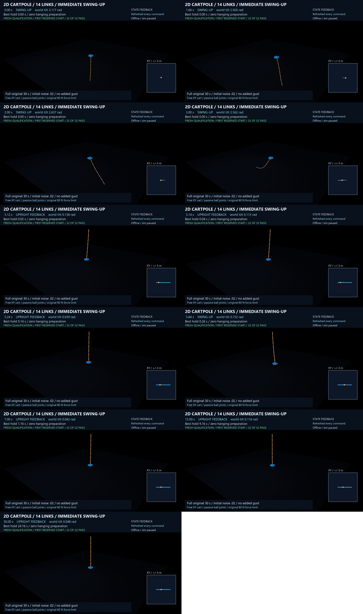

# 14-link 2D immediate noisy swing-up

**32/32 fresh starts pass**, following 45/45 development states. Zero hanging
conditioning; original 30-second task and at least 5-second upright hold. Minimum observed hold:
24.16 s. Free XY cart, passive unrestricted ball
joints, all 44 physical velocities; 80 N radial float32 force; 3 m square; 200 Hz float64 RK4.
The conditioned 14-link result remains a separate comparator.

[Full 50 fps video](https://github.com/corbensorenson/cartpole/releases/download/2d-cartpole-14-link-immediate-v1/2d-cartpole-14-link-immediate-v1.mp4) ·
[Release with all runtime/evidence parts](https://github.com/corbensorenson/cartpole/releases/tag/2d-cartpole-14-link-immediate-v1)

## Qualified immediate frontier

| Tier | Required sigma50 per axis | Required both-sign mass tolerance | Highest qualified count |
|---|---:|---:|---:|
| E | None | None | **14** |
| M1 | >=1e-4 N | >=1e-6 | Not established |
| M2 | >=1e-3 N | >=1e-4 | Not established |
| M3 | >=1e-2 N | >=1e-3 | Not established |

Each M-tier entry requires fresh-32 E qualification of that controller and a
standard development-margin measurement meeting both thresholds. This result
establishes E only.

## Runtime and compute

**Offline per-episode planning with simulation paused**, then full-state
simulator feedback. This is not a hardware real-time controller. Planning takes
place before physical motion; no stationary physical conditioning is used.
The separately timed first-case extracted-runtime re-synthesis used
6,554,044 planning native steps and
841.359 s (about 14 minutes) of pure planning.

Every qualification episode's cost is listed below. Wall includes registration,
planning, independent numerical audit and both actual/cold witnesses; it is
not mislabeled as pure planning. Native validation work is explicit.

| Fresh seed | Actor planning native | Numerical audit native | Total native incl. witnesses | Total case wall (s) |
|---|---:|---:|---:|---:|
| 20263816 | 6,554,044 | 64,780 | 6,642,824 | 1299.391 |
| 20263817 | 6,554,068 | 64,780 | 6,642,848 | 1354.891 |
| 20263818 | 4,443,444 | 114,112 | 4,581,556 | 1069.094 |
| 20263819 | 6,555,952 | 66,472 | 6,646,424 | 1382.359 |
| 20263820 | 6,556,288 | 66,820 | 6,647,108 | 1376.563 |
| 20263821 | 6,628,060 | 136,600 | 6,788,660 | 1488.453 |
| 20263822 | 4,369,064 | 41,528 | 4,434,592 | 940.297 |
| 20263823 | 6,557,908 | 68,260 | 6,650,168 | 1344.641 |
| 20263824 | 6,553,088 | 63,684 | 6,640,772 | 1339.625 |
| 20263825 | 6,557,468 | 67,804 | 6,649,272 | 1327.359 |
| 20263826 | 4,370,128 | 42,156 | 4,436,284 | 916.343 |
| 20263827 | 6,553,968 | 64,652 | 6,642,620 | 1333.797 |
| 20263828 | 6,554,564 | 65,092 | 6,643,656 | 1392.203 |
| 20263829 | 6,558,400 | 68,672 | 6,651,072 | 1487.813 |
| 20263830 | 4,369,024 | 41,436 | 4,434,460 | 1099.391 |
| 20263831 | 6,560,984 | 71,128 | 6,656,112 | 1742.922 |
| 20263832 | 6,555,444 | 66,052 | 6,645,496 | 1973.438 |
| 20263833 | 4,368,240 | 40,756 | 4,432,996 | 1160.250 |
| 20263834 | 6,557,660 | 67,904 | 6,649,564 | 1915.469 |
| 20263835 | 4,442,508 | 113,176 | 4,579,684 | 1446.516 |
| 20263836 | 6,554,924 | 65,364 | 6,644,288 | 1731.578 |
| 20263837 | 6,558,652 | 68,784 | 6,651,436 | 1738.875 |
| 20263838 | 4,440,732 | 110,584 | 4,575,316 | 1252.969 |
| 20263839 | 6,559,536 | 69,720 | 6,653,256 | 1410.859 |
| 20263840 | 6,554,044 | 64,708 | 6,642,752 | 1412.047 |
| 20263841 | 6,555,308 | 65,640 | 6,644,948 | 1389.859 |
| 20263842 | 4,369,288 | 41,472 | 4,434,760 | 925.828 |
| 20263843 | 6,567,932 | 76,876 | 6,668,808 | 1398.344 |
| 20263844 | 6,554,040 | 64,572 | 6,642,612 | 1373.641 |
| 20263845 | 6,561,580 | 71,660 | 6,657,240 | 1330.375 |
| 20263846 | 6,563,600 | 73,436 | 6,661,036 | 1213.734 |
| 20263847 | 6,554,668 | 65,284 | 6,643,952 | 1148.140 |

## Measured disturbance margins

Development 20 starts/cell, unchanged frozen common candidate, parity-guard bypass
diagnostic. Force sigma50 **1.05663693e-06 N per axis**,
95% paired-bootstrap interval [4.2151141088952986e-07, 2.0742037118430286e-06]. Both-sign
uniform relative chain-mass tolerance: **1e-11** (at least 10/20 for each sign, all
smaller sampled magnitudes also pass). Gaussian force is added on EVERY command
before original clipping/float32 delivery. True mass labels do not enter policy.
Full tables, failures and estimator provenance are in development-margins.json.
Tier E qualification and these finite measured margins are distinct claims.

## Reconstruction and evidence

Download all five runtime ZIPs and every evidence ZIP part from the release.
Runtime bytes are unchanged from their development payload freeze; the external
qualification manifest binds that payload to this result. Follow the evidence
README and the isolated reconstruction driver for the first qualified seed
20263816 using pinned original Windows/Python/package versions and empty thread
environment. Re-synthesis blocks original scientific paths and expected results
until planning ends, then checks all planning arrays and actual/cold motion.

All actual/failed/successful forecast tapes for this candidate's qualification
and planned development cases survive in evidence. Regenerable model/value
caches, private notebook copies and shared runtime aliases are declared by hash;
the full first-case expected planning is retained. The 480 disturbance tapes remain
local, hash-listed and regenerable. No extra force-gust or hardware claim beyond
the measured levels is implied. Existing qualified lower counts remain intact.
