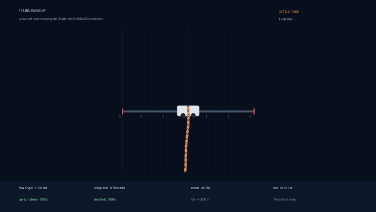
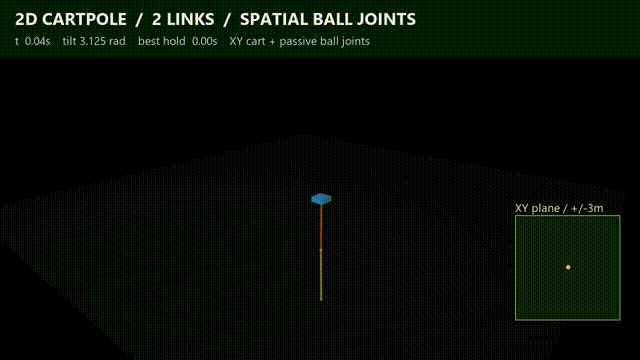

# Cart-Pole · 1D & 2D Control

**Swinging up passive chains with bounded cart forces in MuJoCo.**

Two control benchmarks share this repository: a cart on a **1D rail** carrying a
planar hinge chain, and a cart on a **2D plane** carrying a spatial ball-joint
chain. Both start hanging, use full-state feedback, and must finish an
uninterrupted episode within the cart boundary.

[](#1d-cart-pole)
[](#2d-cart-pole)
[](https://mujoco.readthedocs.io/en/3.3.5/)

[1D results](#1d-cart-pole) · [2D results](#2d-cart-pole) ·
[Get started](#get-started) · [Repository map](#repository-map) ·
[Development](DEVELOPMENT.md)

<table>
  <tr>
    <th width="50%">1D cart · planar hinge chain</th>
    <th width="50%">2D cart · spatial ball-joint chain</th>
  </tr>
  <tr>
    <td><a href="https://github.com/corbensorenson/cartpole/releases/tag/fourteen-link-canonical-20261002"></a></td>
    <td><a href="https://github.com/corbensorenson/cartpole/releases/tag/2d-cartpole-2-link-v1"></a></td>
  </tr>
  <tr>
    <td><strong>14 links qualified.</strong> Full 30-second episodes; 8.16 seconds upright. Preview at 2× speed.</td>
    <td><strong>2 links qualified.</strong> Full 30-second episodes; 21.68 seconds upright.</td>
  </tr>
  <tr>
    <td><a href="runs/swingup14_uniform/fourteen_link_swingup_success.mp4">Full video</a> · <a href="docs/fourteen_link_swingup_paper.md">Technical appendix</a> · <a href="https://github.com/corbensorenson/cartpole/releases/tag/fourteen-link-canonical-20261002">Release</a></td>
    <td><a href="https://github.com/corbensorenson/cartpole/releases/download/2d-cartpole-2-link-v1/2d-cartpole-2-link-swingup.mp4">Full video</a> · <a href="2d/README.md">Method & evidence</a> · <a href="https://github.com/corbensorenson/cartpole/releases/tag/2d-cartpole-2-link-v1">Release</a></td>
  </tr>
</table>

*Published status: October 16, 2026. Link counts belong to their respective
benchmarks; their plants and qualification cohorts differ.*

## 1D cart-pole

One force moves a cart along a finite rail. The links are passive revolute
joints, so the chain moves in a vertical plane. The canonical plant has a
3 m / 1 kg uniform chain, a 1 kg cart, **±80 N** force and **±3 m** rail.
Control runs at **50 Hz**, with native MuJoCo RK4 integration at 200 Hz.

**Seven through fourteen links have published accepted results.** The latest,
fourteen, passes reserved noisy **20/20**, disjoint noisy **100/100**, exact
**20/20**, and a held-out video episode. All 141 episodes finish 30 seconds and
hold every link's absolute world angle below 0.15 rad for 8.16 consecutive
seconds. Maximum cart excursion is 1.863169 m.

The controller combines a settled launch, a trajectory with time-varying
feedback, and upright capture/maintenance. Higher-count synthesis transfers
predecessor routes, repairs them on the exact target plant, and rebuilds
feedback from physical execution. Delivered actions are float32; simulation
and stored physical states are binary64. The fourteen-link capture gain uses
100-digit Riccati design. Saved-controller validation and automatic
re-synthesis are separate claims.

| Milestone | Status | Evidence |
| :--- | :--- | :--- |
| 7–10 links | Accepted; historical regression references | [Consolidated paper](output/pdf/seven_to_ten_link_swingup_paper.pdf) · [Result index](docs/one-dimensional-guide.md#published-results) |
| 11–13 links | Accepted; full release bundles | [11](docs/eleven_link_swingup_paper.md) · [12](docs/twelve_link_swingup_paper.md) · [13](docs/thirteen_link_swingup_paper.md) |
| **14 links** | **Highest accepted 1D count in this repository** | [Appendix](docs/fourteen_link_swingup_paper.md) · [Manifest](runs/swingup14_uniform/fourteen_link_swingup_manifest.json) · [Release](https://github.com/corbensorenson/cartpole/releases/tag/fourteen-link-canonical-20261002) |
| 15 links | **Unsolved:** published nominal partial hold of 3.00 s | [Failure analysis](docs/fifteen_link_partial_result.md) · [Full attempt](runs/fifteen_link_partial_20261015/fifteen_link_partial_full_attempt.mp4) |

The fifteen-link partial result is below the required five-second hold. Every
published attempt later exits the rail before the full episode ends; no noisy
or reserved fifteen-link cohort has passed. The [1D campaign](ROADMAP.md)
targets sequential qualification through twenty links.

**Explore 1D:** [Results & reproduction guide](docs/one-dimensional-guide.md) ·
[Shared solver](docs/generalized_solver.md) · [Campaign contract](ROADMAP.md)

## 2D cart-pole

Two forces move a cart across an XY plane. Each link has an **unrestricted
passive ball joint**: it can tilt in both horizontal directions and twist.
This is spatial motion, with quaternion orientations and tangent-rotation
feedback differences.

The uniform chain is 3 m / 1 kg and the cart is 1 kg. The **total XY force norm
is capped at 80 N**, and the cart must stay inside a **6 m × 6 m square**,
including physics substeps. Commands run at 50 Hz; RK4 integrates at 200 Hz.
Success requires a complete 30-second episode and every rod's world tilt below
0.15 rad for five consecutive seconds. Free twist is not scored as tilt.

| Milestone | Fresh noisy qualification | Upright hold | Evidence |
| :--- | :--- | :--- | :--- |
| 1 link | **32/32** complete episodes | 21.74 s | [Full video](https://github.com/corbensorenson/cartpole/releases/download/2d-cartpole-1-link-v1/2d-cartpole-1-link-swingup.mp4) · [Release](https://github.com/corbensorenson/cartpole/releases/tag/2d-cartpole-1-link-v1) |
| **2 links** | **32/32** complete episodes | 21.68 s | [Full video](https://github.com/corbensorenson/cartpole/releases/download/2d-cartpole-2-link-v1/2d-cartpole-2-link-swingup.mp4) · [Release](https://github.com/corbensorenson/cartpole/releases/tag/2d-cartpole-2-link-v1) |
| 3 links | In development | — | [Progress log](2d/PROGRESS.md) |

Native MuJoCo finite differences feed iLQR trajectory optimization. A finite
feedback table tracks the swing, then hands off to upright discrete LQR.
The two-link result uses world tilt/rate coordinates for stationary feedback;
the failed local-coordinate handoff is preserved alongside it.

The final qualification uses fresh 3D hanging-start perturbations and checks
actual float32 forces, full state/action tapes, and independent replay.
Near-upright balance studies have their own results and do not promote a
hanging-start swing-up count.

**Explore 2D:** [Setup, physics & method](2d/README.md) ·
[Progress](2d/PROGRESS.md) · [Research plan](2d/research/plan.md) ·
[Frozen evidence](2d/evidence)

## Get started

### Watch or inspect a result

Start with a release above for the full video and downloadable evidence.
The [1D guide](docs/one-dimensional-guide.md) indexes historical results and
explains frozen-source reproduction. The [2D guide](2d/README.md) includes
installation, controller evaluation, and video commands.

### Run the 2D environment

From the repository root on Windows, create its separate Python 3.11 environment:

```powershell
cd 2d
py -3.11 -m venv .venv
.\.venv\Scripts\python.exe -m pip install -r requirements-lock.txt
.\.venv\Scripts\python.exe -m pip install -e .
$env:OPENBLAS_NUM_THREADS='1'
$env:OMP_NUM_THREADS='1'
.\.venv\Scripts\python.exe -m pytest -q
```

Then follow the [frozen-controller evaluation commands](2d/README.md#run-on-windows).
Use a new output directory for each run.

### Reproduce a 1D release

Use that release's **frozen source bundle, recorded runtime, and command file**.
The latest repository combines ongoing work and several optimizer environments;
installing one generic environment is not a substitute for a release's recorded
setup. Begin with the [fourteen-link reproduction notes](docs/one-dimensional-guide.md#reproduce-the-fourteen-link-release).

## Repository map

| Path | Purpose |
| :--- | :--- |
| [`src/gcartpole/`](src/gcartpole) | 1D environment and controllers |
| [`configs/`](configs) · [`scripts/`](scripts) | 1D plants, synthesis, evaluation and verification |
| [`docs/`](docs) | 1D papers, method notes and evidence guides |
| [`runs/`](runs) | Reviewed public 1D controllers, manifests, tapes and videos |
| [`2d/src/spatialpole/`](2d/src/spatialpole) | 2D spatial environment and controller tools |
| [`2d/evidence/`](2d/evidence) · [`2d/videos/`](2d/videos) | Frozen 2D evidence and full videos |
| [`2d/research/`](2d/research) | 2D experiment contracts and research records |
| [`tests/`](tests) · [`2d/tests/`](2d/tests) | Each track's tests |
| [`DEVELOPMENT.md`](DEVELOPMENT.md) | Contribution, worktree and publication workflow |

## Evidence and citation

Accepted results include frozen controllers and source identities, declared
cohorts, complete episodes, and full videos. Failed attempts and partial results
keep their original status. A passing reset-noise cohort establishes performance
on that distribution; broader disturbance robustness and indefinite balance
require separate experiments.

Use [CITATION.cff](CITATION.cff) to cite the project, and include the relevant
release tag or source commit when reporting a numerical result.
